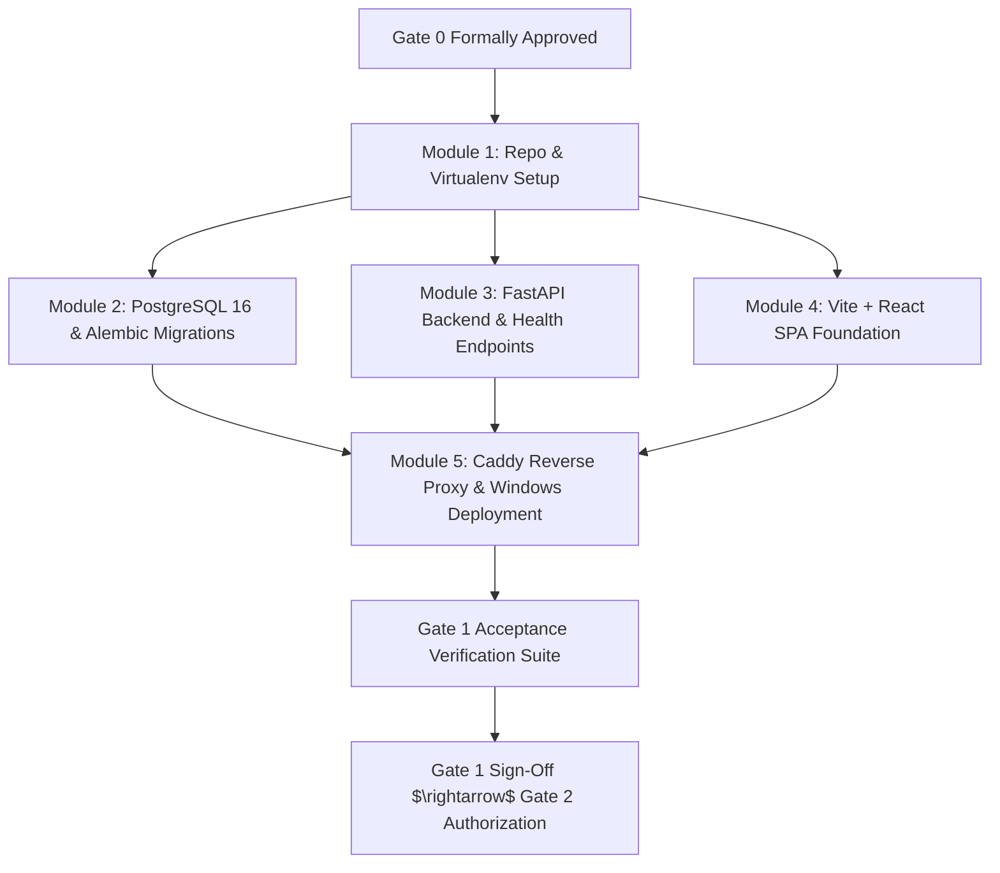

# SCRIPT SCRAPPER — GATE 1 IMPLEMENTATION PLAN (FOUNDATION SETUP)

**Document Version:** 1.0  
**Authority:** Jarvis — CTO / Architecture and Quality Governance  
**Date:** November 6, 2026  
**Status:** Approved for Gate 1 Execution (Pending Final Gate 0 Sign-Off)  
**Host Environment:** Windows 10/11 / Windows Server (64-bit), Antigravity IDE  

---

## 1. GATE 1 OBJECTIVE & SCOPE BOUNDARIES

The sole objective of **Gate 1 (Foundation Implementation)** is to establish a verified, runnable, end-to-end application skeleton where all five foundational infrastructure components communicate reliably:
1. Vite + React frontend builds and serves cleanly.
2. Caddy reverse proxy terminates HTTPS and proxies `/api/v1/`.
3. FastAPI backend starts, validates configuration, and logs structured output.
4. PostgreSQL 16 database accepts connections and runs Alembic migrations.
5. Windows host services and storage directory permissions are verified.

> [!IMPORTANT]
> **GATE 1 BOUNDARY RESTRICTION:**  
> Gate 1 is foundation implementation only. The engineering team must **NOT** begin document parsing, OCR algorithms, AI analysis prompts, multi-user project workflows, or report generation until their respective milestone gates (Gate 2 through Gate 6) are formally authorized.

---

## 2. MODULAR IMPLEMENTATION BREAKDOWN

### Module 1: Repository & Project Foundation
- **Goal:** Establish standard workspace directories, configuration templates, and developer tooling.
- **Tasks:**
  1. Create directory structure: `frontend/`, `backend/`, `storage/` (`originals/`, `extracted/`, `processing/`, `temporary/`, `backups/`, `emails/`), `infrastructure/`, `scripts/`, `tests/`.
  2. Add `.gitkeep` files in empty storage directories to preserve tree in Git.
  3. Create isolated Python 3.13 64-bit virtual environment: `python -m venv .venv`.
  4. Create `backend/requirements.txt` with locked versions:
     `fastapi==0.110.*`, `uvicorn==0.29.*`, `sqlalchemy==2.0.*`, `alembic==1.13.*`, `asyncpg==0.29.*`, `pydantic==2.6.*`, `pydantic-settings==2.2.*`, `argon2-cffi==23.1.*`, `pure-magic==1.21.*`, `pymupdf==1.24.*`.
  5. Configure Ruff / Flake8 / Black and Pre-Commit hooks for backend linting.
  6. Generate local development `.env` from committed `.env.example`.

### Module 2: Database Foundation
- **Goal:** Connect to PostgreSQL 16, initialize Alembic, and apply the initial identity schema.
- **Tasks:**
  1. Verify PostgreSQL 16 Windows service is running on port 5432.
  2. Create database `script_scrapper` and user `script_scrapper_user`.
  3. Configure SQLAlchemy 2.0 AsyncEngine in `backend/app/database/connection.py`:
     ```python
     engine = create_async_engine(
         settings.DATABASE_URL,
         pool_size=30,
         max_overflow=10,
         pool_timeout=30.0,
         pool_recycle=1800.0,
         pool_pre_ping=True
     )
     ```
  4. Initialize Alembic: `alembic init -t async migrations`.
  5. Author migration `0001_initial_schema.py` creating the 14 core tables (`users`, `user_verifications`, `user_sessions`, `projects`, `project_members`, `scripts`, `script_versions`, `processing_jobs`, `scenes`, `scene_elements`, `characters`, `character_aliases`, `analysis_runs`, `analysis_results`, `audit_logs`).
  6. Execute migration: `alembic upgrade head`. Verify schema and partial indexes in `psql`.

### Module 3: Backend Foundation
- **Goal:** Build the minimal, production-ready FastAPI application with health checks and logging.
- **Tasks:**
  1. Implement `backend/app/core/config.py` using `pydantic-settings` to load and validate all `.env` variables with strict type checking.
  2. Implement structured JSON logging in `backend/app/core/logging.py`.
  3. Implement global exception handlers in `backend/app/core/exceptions.py` returning standard error envelopes (`{"success": false, "error": {"code": "...", "message": "..."}}`).
  4. Implement base API router `backend/app/api/v1/router.py` mounted at `/api/v1`.
  5. Implement healthcheck endpoints:
     - `GET /api/v1/health` — Returns 200 OK and uptime.
     - `GET /api/v1/system/status` — Tests active database connectivity via `SELECT 1` and reports pool statistics.
  6. Run backend locally via Uvicorn: `uvicorn app.main:app --host 127.0.0.1 --port 8000`.

### Module 4: Frontend Foundation
- **Goal:** Initialize Vite + React SPA, configure Tailwind CSS, shadcn/ui foundation, and API client.
- **Tasks:**
  1. Initialize Vite project: `npm create vite@latest frontend -- --template react-ts`.
  2. Install and configure Tailwind CSS and `postcss`.
  3. Install Radix UI primitives and configure initial `shadcn/ui` components (`Button`, `Card`, `Input`, `Alert`).
  4. Configure client-side routing via `react-router-dom`:
     - `/` — Landing / Redirect.
     - `/login` — Login page placeholder.
     - `/register` — Public registration placeholder.
     - `/dashboard` — Main layout shell.
  5. Configure Axios / Fetch API client (`frontend/src/services/api-client.ts`) with base URL `/api/v1` and automatic CSRF header injection.
  6. Configure TanStack Query (`QueryClientProvider`) for server state management.
  7. Verify production build: `npm run build` generates clean assets in `frontend/dist/`.

### Module 5: Windows Deployment Foundation
- **Goal:** Configure Caddy reverse proxy, local CA trust, storage permissions, and Windows Firewall.
- **Tasks:**
  1. Author `Caddyfile` in repository root configuring reverse proxying, static file serving, SPA route fallback (`try_files {path} /index.html`), and `/system/ca.crt` root download.
  2. Launch Caddy: `caddy.exe run --config Caddyfile`.
  3. Verify local HTTPS on `https://localhost` and LAN IP `https://HOST-IP`.
  4. Configure NTFS permissions on `storage/` and CA private key:
     ```powershell
     icacls "$env:LOCALAPPDATA\Caddy\certificates\local\root.key" /inheritance:r /grant:r "SYSTEM":(F) "Administrators":(F)
     ```
  5. Create Windows Firewall rule restricting ports 80/443 to the local LAN subnet (`192.168.0.0/16`, `10.0.0.0/8`).
  6. Execute empirical backup and restoration test (`scripts/backup.ps1` and `scripts/restore.ps1`) against the newly initialized Gate 1 database.

---

## 3. GATE 1 EXECUTION SEQUENCE


