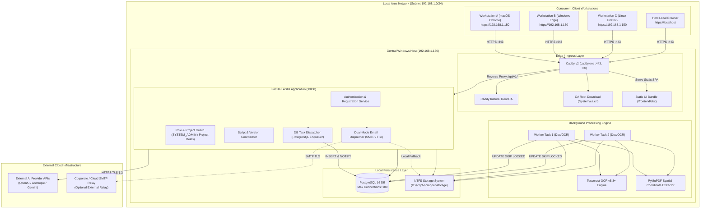
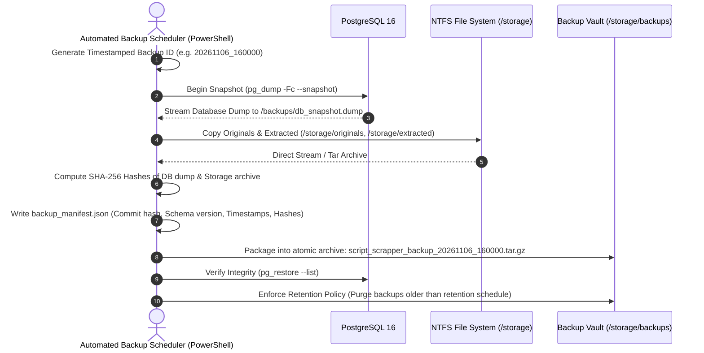

# SCRIPT SCRAPPER

## FINAL ARCHITECTURE BASELINE v1.3 (GATE 0 FINAL CLOSURE)

**Document Classification:** Authoritative Technical Architecture & Development Governance  
**Version:** 1.3 (Final Gate 0 Baseline)  
**Status:** Approved for Gate 0 Closure Preparation  
**Product:** Script Scrapper  
**Architecture Owner:** System Architect / CTO  
**Auditor & Engineering Collective:** Principal Software Architect, Senior Backend Engineer, Senior Frontend Engineer, DevOps Architect, Security Engineer, QA Architect  
**Development Environment:** Antigravity IDE  
**Primary Host Environment:** Windows 10/11 / Windows Server (64-bit)  
**Primary Governance Authority:** System Architect Final Decision Amendments  

---

# PART 1 — PROJECT DEFINITION & AUTHORITATIVE REQUIREMENTS

## 1.1 Product Overview
Script Scrapper is a lightweight, web-based screenplay processing and analysis application deployed on a centralized Windows workstation or local server. It provides concurrent multi-user web access across multiple client computers over an encrypted Local Area Network (LAN), as well as on the host machine itself.

The application allows authenticated writers, script analysts, directors, and production teams to upload screenplays (PDF, DOCX, TXT, Fountain), execute automatic spatial parsing and Optical Character Recognition (OCR), perform deterministic scene and dialogue extraction, collaborate across permission-bounded projects, and run external AI-assisted screenplay evaluations.

## 1.2 The 16 Mandatory Architecture Directives

| # | Mandatory Directive | Architectural Baseline v1.3 Implementation |
| :---: | :--- | :--- |
| **1** | **Windows Central Host OS** | Native Windows Services managed via WinSW/NSSM; long path support enabled; deterministic context-managed file handles. |
| **2** | **Multi-Computer LAN Access** | Central Windows host runs Caddy v2 reverse proxy binding to `0.0.0.0:443`, serving static Vite UI and proxying `/api/v1/` to FastAPI. |
| **3** | **Public User Registration** | Open endpoint `POST /api/v1/auth/register` with strict Pydantic validation rejecting elevated roles. Default is immutable `SYSTEM_ADMIN` exclusion. |
| **4** | **Email Verification Required** | High-entropy 256-bit token stored as SHA-256 hash in `user_verifications`, expiring in 24 hours. Dual-mode mailer (SMTP / File fallback). |
| **5** | **Default Role: STANDARD_USER** | Hardcoded database column default `system_role VARCHAR(20) DEFAULT 'STANDARD_USER'`. Registration payload ignores any role parameter. |
| **6** | **No Public SYSTEM_ADMIN Grant**| `SYSTEM_ADMIN` privileges can never be granted via public registration; role elevation requires direct existing `SYSTEM_ADMIN` authorization. |
| **7** | **Single Primary Project Owner** | `projects.owner_id UUID NOT NULL REFERENCES users(id)` guarantees exactly one owner per project. Owner has exclusive deletion/transfer rights. |
| **8** | **PROJECT_EDITOR & VIEWER Roles** | `project_members.role` enum supports `PROJECT_EDITOR` (upload, process, edit tags) and `PROJECT_VIEWER` (read-only access). |
| **9** | **Searchable & Scanned PDFs** | Automated page classifier evaluates text word count ($\ge 30$) and character area coverage ($\ge 70\%$) to route between native and scanned processing. |
| **10**| **Scanned PDFs Require OCR** | Scanned pages rasterized at 300 DPI via PyMuPDF `get_pixmap()`, preprocessed with Otsu thresholding, extracted via Tesseract OCR v5.3+. |
| **11**| **External AI APIs Used** | Provider-agnostic service interface (`ai/providers/`) wrapping OpenAI, Anthropic, and Gemini with prompt versioning and Pydantic validation. |
| **12**| **Lightweight Standalone App** | Vite SPA (no Node runtime), PostgreSQL SKIP LOCKED (no Redis), Caddy single binary (`caddy.exe`). Idle host memory target: <350MB RAM. |
| **13**| **PostgreSQL Approved Database** | PostgreSQL 16 with JSONB for analysis results, partial unique index for active versions, and connection pooling via `asyncpg`. |
| **14**| **Vite + React Approved Frontend**| Single-page application using React 18, TypeScript, Tailwind CSS, shadcn/ui, Zustand, and TanStack Query. Static build served by Caddy. |
| **15**| **Caddy Approved Reverse Proxy** | Caddy v2 statically linked executable (`caddy.exe`) providing automated internal CA TLS, static file serving, and `/api/v1/` reverse proxying. |
| **16**| **PostgreSQL SKIP LOCKED Queue** | Workers poll `processing_jobs` via `UPDATE ... FOR UPDATE SKIP LOCKED` combined with PostgreSQL `LISTEN / NOTIFY` to eliminate CPU spin. |

---

# PART 2 — SYSTEM ARCHITECTURE & TOPOLOGY



---

# PART 3 — POSTGRESQL CONNECTION MANAGEMENT & POOLING

## 3.1 Single Database Pooling Strategy: SQLAlchemy AsyncEngine with asyncpg
To guarantee architectural consistency and prevent incompatible configuration collisions, Script Scrapper mandates **one single database connection pooling strategy**:

- **Framework Strategy:** **SQLAlchemy 2.0 `AsyncEngine` with the `asyncpg` driver** (`create_async_engine("postgresql+asyncpg://...")`).
- **Connection Pool Class:** SQLAlchemy's native `AsyncAdaptedQueuePool`.
- **Strict Parameter Standard:** Direct configuration parameters for `asyncpg.create_pool` (`min_size`, `max_size`, `command_timeout`) are strictly prohibited from mixing with SQLAlchemy pool parameters.

### SQLAlchemy AsyncEngine Configuration Parameters
```python
engine = create_async_engine(
    DATABASE_URL,
    pool_size=30,          # Base connection pool maintained by the engine
    max_overflow=10,       # Maximum transient burst connections under heavy surge
    pool_timeout=30.0,     # Seconds to wait before raising TimeoutError if pool is full
    pool_recycle=1800.0,   # Recycle connections older than 30 minutes (prevents stale TCP)
    pool_pre_ping=True,    # Emit test SELECT 1 to discard disconnected sockets
    echo=False
)
```

## 3.2 Aggregate Application Connection Budget (Max: 100)
PostgreSQL 16 on Windows defaults to `max_connections = 100`. The aggregate application connection budget is strictly partitioned across processes to guarantee zero connection starvation:

```text
====================================================================================================
                        POSTGRESQL 16 CONNECTION BUDGET (MAX: 100)
====================================================================================================

  1. FastAPI Backend (AsyncEngine Pool)      --> pool_size: 30, max_overflow: 10 (Peak API: 40)
  2. Background Worker Pool (Dedicated Slots) --> Exactly 2 connections (1 per worker task)
  3. Admin Operations & Migrations (Alembic)  --> Exactly 5 connections reserved
  4. Monitoring, Healthchecks & Watchdog      --> Exactly 3 connections reserved
  5. PostgreSQL Superuser Reserved Buffer     --> Exactly 3 connections (superuser_reserved_connections)
  6. Unallocated Safety Margin / Free Buffer  --> Exactly 47 connections available
----------------------------------------------------------------------------------------------------
  TOTAL MAXIMUM CONNECTIONS (max_connections) --> 100 CONNECTIONS EXACT (40 + 2 + 5 + 3 + 3 + 47)
====================================================================================================
```

### Connection Budgeting Rules
1. **Per-Process Limit:** The primary FastAPI application process can consume a maximum of 40 connections under peak concurrent client load.
2. **Worker Isolation:** The background worker engine operates in a separate process pool, using exactly 1 connection per active worker concurrency slot (default: 2 slots = 2 connections).
3. **Superuser Protection:** PostgreSQL's parameter `superuser_reserved_connections = 3` reserves 3 slots exclusively for `postgres` superuser logins over localhost, ensuring an administrator can always inspect or terminate processes even during connection pool saturation.
4. **Gate 1 Runtime Validation:** During Gate 1 foundation verification, connection limits and active states will be validated under simulated load via:
   ```sql
   SELECT count(*), state, application_name FROM pg_stat_activity GROUP BY state, application_name;
   ```

---

# PART 4 — POSTGRESQL BACKGROUND JOB ENGINE & FAULT TOLERANCE

## 4.1 Syntactically Valid Atomic Queue Dequeue Engine (CTE Idiom)
Workers claim jobs atomically without row lock contention using PostgreSQL `FOR UPDATE SKIP LOCKED` inside a Common Table Expression (CTE):

```sql
WITH next_job AS (
    SELECT id
    FROM processing_jobs
    WHERE status = 'QUEUED'
    ORDER BY created_at ASC
    FOR UPDATE SKIP LOCKED
    LIMIT 1
)
UPDATE processing_jobs j
SET status = 'PROCESSING',
    started_at = NOW(),
    heartbeat_at = NOW(),
    worker_id = :worker_id,
    attempt_count = j.attempt_count + 1
FROM next_job
WHERE j.id = next_job.id
RETURNING j.*;
```

## 4.2 Strict Transaction Boundaries (Zero Long-Lived Transactions)
**MANDATORY RULE:** Database transactions must **NEVER** be held open during lengthy document extraction, 300 DPI image rasterization, Tesseract OCR processing, or external AI API calls. Holding transactions open during multi-minute processing exhausts connections and locks table rows.

### The 3-Phase Job Execution Lifecycle
1. **Phase 1: Atomic Claim (Short Transaction, <50ms):**
   Worker claims the job via CTE `FOR UPDATE SKIP LOCKED`, sets `status = 'PROCESSING'`, and **commits the transaction immediately**.
2. **Phase 2: Heavy Work Execution (OUTSIDE Database Transactions):**
   - The worker loads the file from disk, performs page classification, executes PyMuPDF coordinate extraction, runs Tesseract OCR, or dispatches external AI API requests completely outside of any active database transaction.
   - **Heartbeat Management:** Every 5 seconds, the worker opens an independent, momentary transaction updating `heartbeat_at = NOW()`:
     ```sql
     UPDATE processing_jobs SET heartbeat_at = NOW() WHERE id = :job_id AND status = 'PROCESSING';
     ```
   - **Cancellation Token Inspection:** Between processing individual pages, the worker inspects job status:
     ```sql
     SELECT status FROM processing_jobs WHERE id = :job_id;
     ```
     If `status == 'CANCELLING'`, the worker terminates processing, cleans up local temporary files, and updates:
     ```sql
     UPDATE processing_jobs SET status = 'CANCELLED', completed_at = NOW() WHERE id = :job_id;
     ```
3. **Phase 3: Atomic Result Persistence (Short Transaction, <200ms):**
   Upon successful parsing completion, the worker opens a single database transaction to idempotently persist results:
   ```sql
   BEGIN;
   -- 1. Idempotency enforcement: Purge any partial previous parsing for this script version
   DELETE FROM scene_elements WHERE scene_id IN (SELECT id FROM scenes WHERE script_version_id = :version_id);
   DELETE FROM scenes WHERE script_version_id = :version_id;
   DELETE FROM character_aliases WHERE character_id IN (SELECT id FROM characters WHERE script_version_id = :version_id);
   DELETE FROM characters WHERE script_version_id = :version_id;

   -- 2. Bulk insert validated CIR v1.3 scenes, scene_elements, characters, and aliases
   -- ... INSERT statements ...

   -- 3. Mark job completed
   UPDATE processing_jobs SET status = 'COMPLETED', progress_percent = 100, completed_at = NOW() WHERE id = :job_id;
   COMMIT;
   ```

## 4.3 Stale-Job Recovery (Watchdog Sweeper)
A periodic background watchdog inspects running jobs every 15 seconds:
```sql
UPDATE processing_jobs
SET status = CASE 
        WHEN attempt_count >= max_retries THEN 'FAILED'
        ELSE 'QUEUED'
    END,
    error_code = 'WORKER_TIMEOUT',
    error_message = 'Worker process terminated or heartbeat timed out (>45s)',
    worker_id = NULL
WHERE status = 'PROCESSING'
  AND heartbeat_at < NOW() - INTERVAL '45 seconds';
```

## 4.4 Retry Limits & Exponential Backoff
- `max_retries`: Hardcoded ceiling of 3 attempts.
- Exponential backoff delay calculation:
  $$\text{Delay} = \min\left(60\text{ seconds}, 2^{\text{attempt\_count}} \times 5\text{ seconds}\right)$$
- If `attempt_count >= max_retries`, the job permanently transitions to `FAILED` with explicit `error_code` and `error_message`.

## 4.5 CPU Spin Prevention & Polling Fallback
- `LISTEN / NOTIFY` is used **strictly as a wake-up signal**:
  - When backend enqueues a job, it executes: `PERFORM pg_notify('new_job_channel', NEW.id::text);`.
  - Workers listen asynchronously (`LISTEN new_job_channel`).
  - When the queue is empty, the worker sleeps awaiting the PostgreSQL notify event.
  - **Polling Fallback:** If notify events are missed or disconnects occur, the worker loop enforces a 5-second polling fallback timeout, guaranteeing jobs never remain stuck in `QUEUED`.

---

# PART 5 — CADDY CERTIFICATE AUTHORITY SECURITY & RECOVERY

## 5.1 Persistent CA Identity & Private Key Protection
- **Persistent CA Directory:** `%LOCALAPPDATA%\Caddy\certificates\local\`
- **Private Key Storage Security:** The root CA private key (`root.key`) is generated once and stored on the local NTFS filesystem. During host setup, access is locked using explicit NTFS Access Control Lists (ACLs):
  ```powershell
  icacls "$env:LOCALAPPDATA\Caddy\certificates\local\root.key" /inheritance:r /grant:r "SYSTEM":(F) "Administrators":(F)
  ```
- **Operational Rule:** Operators must **NEVER** delete the CA storage directory as a routine troubleshooting or recovery operation. Deleting the CA directory destroys the root identity and invalidates the certificate trust on all configured client computers across the LAN.

## 5.2 Out-of-Band Root Certificate Fingerprint Verification
To prevent Man-in-the-Middle (MITM) attacks and ensure authentic certificate distribution:
- Operators and client users must **NEVER** treat an insecure HTTP download as proof of certificate authenticity.
- Upon host initialization, Caddy's root certificate SHA-256 fingerprint is calculated and recorded out-of-band:
  ```powershell
  (Get-FileHash "$env:LOCALAPPDATA\Caddy\certificates\local\root.crt" -Algorithm SHA256).Hash
  ```
- This fingerprint is displayed on the host administrator console and embedded in the static client trust documentation (`https://HOST-IP/setup/trust`).
- Remote users must verify that the downloaded `ca.crt` SHA-256 fingerprint matches the host's published fingerprint before importing it into their OS trust store.

## 5.3 Planned CA Rotation Procedure
When the internal root certificate approaches expiration (Caddy root certificates have a 10-year validity window by default, leaf certificates 12 hours):
1. **Pre-Generation:** Generate the new root CA certificate out-of-band.
2. **Dual-Trust Window:** Distribute and install the new root CA certificate into client machines' trusted root stores alongside the existing root CA.
3. **Cutover:** Update Caddy's configuration to issue leaf certificates using the new root CA.
4. **Decommission:** Once all clients trust the new root CA, the legacy root CA is pruned from client trust stores.

## 5.4 Backup of CA Material
Caddy's root certificate and encrypted key material are included in the automated coordinated backup archive (`storage/backups/`) to ensure the host can be restored after a disaster without forcing all LAN client workstations to re-import certificates.

---

# PART 6 — SCREENPLAY CIR v1.3 COORDINATE CONTRACT

## 6.1 Coordinate Space Specification
The Common Intermediate Representation (CIR v1.3) defines an absolute, standardized coordinate system:
- **Coordinate Origin:** Top-left corner `(0, 0)` of the visible page.
- **Measurement Units:** Typographical points ($1\text{ pt} = 1/72\text{ inch}$).
- **CropBox vs. MediaBox Reference:** Coordinates are strictly referenced to the page's visible `CropBox` (falling back to `MediaBox` if CropBox is absent). PyMuPDF's `page.rect` automatically accounts for non-zero CropBox origins.
- **Rotation Normalization:** If a PDF page specifies rotation (`/Rotate = 90, 180, 270`), all extracted word and block coordinates are mathematically transformed to standard unrotated 0° orientation prior to persistence.
- **OCR Coordinate Mapping:** Tesseract OCR outputs pixel coordinates at 300 DPI. Coordinates are converted to 72 DPI points:
  $$x_{\text{pt}} = x_{\text{px}} \times \frac{72}{300}, \quad y_{\text{pt}} = y_{\text{px}} \times \frac{72}{300}$$
- **Bounding Box Validation:** All element bounding boxes must satisfy:
  $$0 \le x_0 < x_1 \le W_{\text{page}} \quad \text{and} \quad 0 \le y_0 < y_1 \le H_{\text{page}}$$

## 6.2 Proportional Typographical Margins (A4 and US Letter Support)
Screenplays formatted on International A4 paper ($595.28 \times 841.89\text{ pt}$) differ in width from US Letter ($612 \times 792\text{ pt}$). To achieve identical parsing accuracy across both standards, typographical margin classification evaluates relative horizontal percentages $\frac{x_0}{W_{\text{page}}}$:

| Screenplay Element | Relative Horizontal Position ($x_0 / W_{\text{page}}$) | Relative Column Width |
| :--- | :---: | :---: |
| **Scene Heading / Slugline** | $17.6\% \pm 3.0\%$ | Full page width |
| **Action Paragraph** | $17.6\% \pm 3.0\%$ | Width $\ge 60\%$ of page |
| **Character Cue** | $43.5\% \pm 4.0\%$ | Indented ~3.7" (Letter) / ~91mm (A4) |
| **Parenthetical** | $36.5\% \pm 3.5\%$ | Indented ~3.1" (Letter) / ~76mm (A4) |
| **Dialogue Block** | $29.4\% \pm 3.5\%$ | Width $\le 45\%$ of page |
| **Transition** | $\ge 64.0\%$ (Right-aligned) | Short phrase ending in colon (`CUT TO:`) |

## 6.3 Gate 3 Screenplay Test Fixture Specifications
In accordance with governance rules, parsing accuracy cannot be claimed until empirical corpus testing is executed in Gate 3. The test suite must include:
1. `us_letter_sample.pdf` — Standard Courier 12pt on US Letter paper ($612 \times 792\text{ pt}$).
2. `a4_sample.pdf` — Standard Courier 12pt on International A4 paper ($595 \times 842\text{ pt}$).
3. `rotated_90deg_sample.pdf` — PDF with landscape orientation (`/Rotate = 90`).
4. `cropped_non_zero_origin_sample.pdf` — PDF with non-zero CropBox offset (`CropBox = [36, 36, 648, 828]`).
5. `scanned_300dpi_ocr_sample.pdf` — High-noise scanned PDF requiring Tesseract OCR.

## 6.4 CIR v1.3 JSON Schema Structure
```json
{
  "$schema": "https://scriptscrapper.local/schemas/cir-v1.3.json",
  "document_id": "c1f8a847-79b8-4e89-9a1b-e52b2e88a31e",
  "version_number": 1,
  "source_format": "pdf",
  "extraction_summary": {
    "total_pages": 112,
    "native_pages": 108,
    "scanned_ocr_pages": 4,
    "average_ocr_confidence": 97.4,
    "processed_at": "2026-11-06T16:05:00Z"
  },
  "metadata": {
    "title": "THE CHINATOWN PROJECT",
    "author": "Robert Towne"
  },
  "scenes": [
    {
      "sequence_index": 1,
      "scene_number": "1",
      "slugline": "INT. GITTES' OFFICE - DAY",
      "setting": "GITTES' OFFICE",
      "time_of_day": "DAY",
      "int_ext": "INT",
      "page_start": 1,
      "page_end": 2,
      "elements": [
        {
          "sequence_index": 1,
          "element_type": "action",
          "content": "JAKE GITTES sits behind his desk. Across from him sits CURLY, sweating heavily.",
          "page": 1,
          "line_range": [8, 10],
          "bounding_box": {"x0": 108.0, "y0": 142.5, "x1": 504.0, "y1": 166.5}
        },
        {
          "sequence_index": 2,
          "element_type": "character",
          "character_name": "CURLY",
          "character_modifier": null,
          "dual_dialogue_group_id": null,
          "content": "CURLY",
          "page": 1,
          "line_range": [12, 12],
          "bounding_box": {"x0": 266.4, "y0": 180.0, "x1": 310.0, "y1": 192.0}
        },
        {
          "sequence_index": 3,
          "element_type": "parenthetical",
          "content": "breaking down",
          "page": 1,
          "line_range": [13, 13],
          "bounding_box": {"x0": 223.2, "y0": 194.0, "x1": 320.0, "y1": 206.0}
        },
        {
          "sequence_index": 4,
          "element_type": "dialogue",
          "character_name": "CURLY",
          "dual_dialogue_group_id": null,
          "content": "She's no good, Jake. I can't take it anymore.",
          "page": 1,
          "line_range": [14, 16],
          "bounding_box": {"x0": 180.0, "y0": 208.0, "x1": 432.0, "y1": 232.0}
        }
      ]
    }
  ]
}
```

## 6.5 CIR Validation Rules
1. **Scene Chronology:** `sequence_index` must be strictly monotonic and continuous ($1, 2, 3, \dots, N$).
2. **Element Ordering:** Within each scene, `elements.sequence_index` must be strictly monotonic ($1, 2, 3, \dots, M$).
3. **Dialogue Binding:** Any element of type `dialogue` or `parenthetical` must be preceded by an element of type `character` or `parenthetical`.
4. **Dual Dialogue Consistency:** If `dual_dialogue_group_id` is populated, exactly two distinct character cues within the same scene must share that group ID.
5. **Bounding Box Geometric Constraints:** Bounding box coordinates must satisfy $0 \le x_0 < x_1 \le W_{\text{page}}$ and $0 \le y_0 < y_1 \le H_{\text{page}}$ points relative to the unrotated page CropBox.

---

# PART 7 — COORDINATED DATABASE & STORAGE BACKUP SPECIFICATION



### 7.1 Operational Procedure vs. Runtime Test Distinction
The backup script (`scripts/backup.ps1`) and restoration protocol (`scripts/restore.ps1`) are fully specified and syntactically validated for Windows PowerShell. In accordance with Gate 0 restrictions, live empirical execution tests of `pg_dump` and `pg_restore` require an active database instance and are scheduled as an explicit acceptance test during Gate 1.

---

# PART 8 — STANDARDIZED ROLE MATRIX & ACCESS CONTROL (RBAC)

All system administrator role references are formally standardized to **`SYSTEM_ADMIN`**. The term "Administrator" or "Admin" exists solely as colloquial prose; the technical identifier in schemas, database columns, tokens, and audit logs is strictly `SYSTEM_ADMIN`.

## 8.1 System and Project Roles
- **`SYSTEM_ADMIN`:** Global administration, user status management, system-wide audit log inspection, global AI key configuration. Actions are explicitly recorded in `audit_logs`.
- **`STANDARD_USER`:** Default role for all public registrants. Has zero initial project access. Can create new projects (becoming `PROJECT_OWNER`).
- **`PROJECT_OWNER`:** Exactly one primary owner per project (`projects.owner_id`). Has exclusive authority to delete/archive the project, manage collaborators, and transfer ownership.
- **`PROJECT_EDITOR`:** Project collaborator with write access. Can upload scripts, trigger OCR/parsing, trigger AI analysis, and edit scene tags.
- **`PROJECT_VIEWER`:** Project collaborator with read-only access. Can view parsed scenes, character breakdowns, dialogue, and analysis reports.

## 8.2 Atomic Ownership Transfer
Project ownership transfer is executed as an atomic database transaction:
```sql
BEGIN;
-- 1. Transfer primary ownership
UPDATE projects
SET owner_id = :new_owner_id, updated_at = NOW()
WHERE id = :project_id AND owner_id = :current_user_id;

-- 2. Ensure former owner retains editor access
INSERT INTO project_members (project_id, user_id, role, created_at, updated_at)
VALUES (:project_id, :current_user_id, 'PROJECT_EDITOR', NOW(), NOW())
ON CONFLICT (project_id, user_id) DO UPDATE SET role = 'PROJECT_EDITOR', updated_at = NOW();

-- 3. Log ownership transfer audit event
INSERT INTO audit_logs (user_id, action, entity_type, entity_id, status, metadata, created_at)
VALUES (:current_user_id, 'PROJECT_OWNERSHIP_TRANSFERRED', 'PROJECT', :project_id, 'SUCCESS', jsonb_build_object('new_owner_id', :new_owner_id), NOW());
COMMIT;
```

## 8.3 Comprehensive Backend Authorization Coverage
Every incoming API request verifies access on the backend across all 9 domain entities:
1. **Projects:** User must be `owner_id` or present in `project_members`.
2. **Scripts:** Script must belong to an accessible project.
3. **Script Versions:** Version must belong to an accessible script.
4. **Scenes:** Scene must belong to an accessible script version.
5. **Characters & Aliases:** Character must belong to an accessible script version.
6. **Scene Elements & Dialogue:** Elements must belong to an accessible scene.
7. **Files & Uploads:** User must possess `PROJECT_EDITOR` or `PROJECT_OWNER` role on the parent project.
8. **Processing Jobs:** Job must reference an accessible script version; only `EDITOR`/`OWNER` can trigger or cancel.
9. **AI Analysis Runs & Results:** User must possess `PROJECT_EDITOR` or `PROJECT_OWNER` role; external AI transmission requires project-level consent flag.

---

# PART 9 — SECURITY, WINDOWS HOST HARDENING & NETWORK DEPLOYMENT

## 9.1 Network Segmentation & Windows Firewall
To prevent unintentional exposure when Caddy binds to `0.0.0.0`:
1. **Internal Port Binding:**
   - FastAPI Backend (`127.0.0.1:8000` strictly; never exposed to LAN).
   - PostgreSQL 16 (`127.0.0.1:5432` strictly; never exposed to LAN).
2. **Reverse Proxy Binding:** Only Caddy binds to `0.0.0.0:80` and `0.0.0.0:443`.
3. **Windows Firewall Rule:** Inbound connections on ports 80 and 443 are strictly restricted to the local subnet scope (e.g. `192.168.0.0/16`, `10.0.0.0/8`), blocking any public internet access:
   ```powershell
   New-NetFirewallRule -DisplayName "ScriptScrapper-LAN-HTTPS" -Direction Inbound -LocalPort 443 -Protocol TCP -Action Allow -RemoteAddress 192.168.0.0/16,10.0.0.0/8
   ```

## 9.2 Authentication & Secret Management
- **Passwords:** Argon2id with memory cost 64MB, time cost 3, parallelism 4.
- **Email Verification Tokens:** 256-bit cryptographically secure tokens expiring in 24 hours. Token values are hashed with SHA-256 before storage in `user_verifications`.
- **Rate Limiting:** Auth endpoints enforce 5 requests per IP per 15 minutes. 10 consecutive failed logins triggers a 15-minute account lockout (`locked_until`).
- **File Upload Security:** 50MB ceiling, magic bytes inspection, files stored strictly under generated UUID filenames outside web roots.
- **Secrets:** Environment variables loaded from uncommitted `.env`. `.env.example` committed as a reference template. Zero credentials in Git.

---

# PART 10 — FINAL GATE 0 READINESS DECLARATION

This **Final Architecture Baseline v1.3** is the authoritative, immutable engineering blueprint for Script Scrapper. It resolves every finding from Phases 0, 0.1, 0.2, and 0.3.

**Current Governance Status:** Prepared and submitted for formal Gate 0 Closure sign-off by the System Architect and CTO.

**END OF FINAL ARCHITECTURE BASELINE v1.3**
