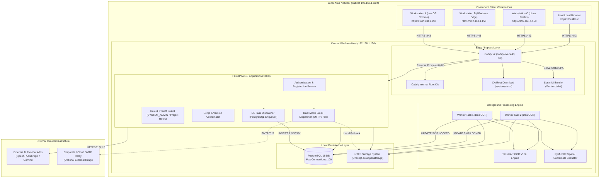
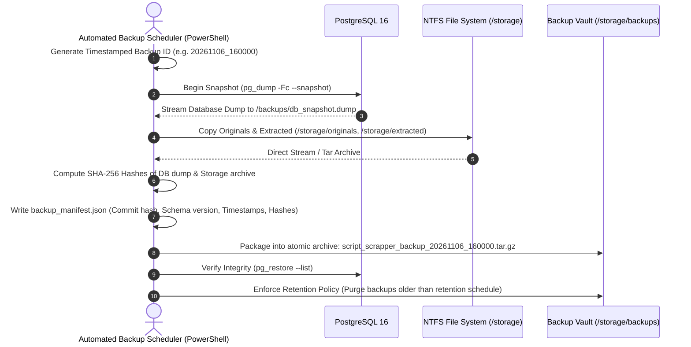

# SCRIPT SCRAPPER

## FINAL ARCHITECTURE BASELINE v1.3 (GATE 0 FINAL CLOSURE)

**Document Classification:** Authoritative Technical Architecture & Development Governance  
**Version:** 1.3 (Final Gate 0 Baseline)  
**Status:** Approved for Gate 0 Closure Preparation  
**Product:** Script Scrapper  
**Architecture Owner:** System Architect / CTO  
**Auditor & Engineering Collective:** Principal Software Architect, Senior Backend Engineer, Senior Frontend Engineer, DevOps Architect, Security Engineer, QA Architect  
**Development Environment:** Antigravity IDE  
**Primary Host Environment:** Windows 10/11 / Windows Server (64-bit)  
**Primary Governance Authority:** System Architect Final Decision Amendments  

---

# PART 1 — PROJECT DEFINITION & AUTHORITATIVE REQUIREMENTS

## 1.1 Product Overview
Script Scrapper is a lightweight, web-based screenplay processing and analysis application deployed on a centralized Windows workstation or local server. It provides concurrent multi-user web access across multiple client computers over an encrypted Local Area Network (LAN), as well as on the host machine itself.

The application allows authenticated writers, script analysts, directors, and production teams to upload screenplays (PDF, DOCX, TXT, Fountain), execute automatic spatial parsing and Optical Character Recognition (OCR), perform deterministic scene and dialogue extraction, collaborate across permission-bounded projects, and run external AI-assisted screenplay evaluations.

## 1.2 The 16 Mandatory Architecture Directives

| # | Mandatory Directive | Architectural Baseline v1.3 Implementation |
| :---: | :--- | :--- |
| **1** | **Windows Central Host OS** | Native Windows Services managed via WinSW/NSSM; long path support enabled; deterministic context-managed file handles. |
| **2** | **Multi-Computer LAN Access** | Central Windows host runs Caddy v2 reverse proxy binding to `0.0.0.0:443`, serving static Vite UI and proxying `/api/v1/` to FastAPI. |
| **3** | **Public User Registration** | Open endpoint `POST /api/v1/auth/register` with strict Pydantic validation rejecting elevated roles. Default is immutable `SYSTEM_ADMIN` exclusion. |
| **4** | **Email Verification Required** | High-entropy 256-bit token stored as SHA-256 hash in `user_verifications`, expiring in 24 hours. Dual-mode mailer (SMTP / File fallback). |
| **5** | **Default Role: STANDARD_USER** | Hardcoded database column default `system_role VARCHAR(20) DEFAULT 'STANDARD_USER'`. Registration payload ignores any role parameter. |
| **6** | **No Public SYSTEM_ADMIN Grant**| `SYSTEM_ADMIN` privileges can never be granted via public registration; role elevation requires direct existing `SYSTEM_ADMIN` authorization. |
| **7** | **Single Primary Project Owner** | `projects.owner_id UUID NOT NULL REFERENCES users(id)` guarantees exactly one owner per project. Owner has exclusive deletion/transfer rights. |
| **8** | **PROJECT_EDITOR & VIEWER Roles** | `project_members.role` enum supports `PROJECT_EDITOR` (upload, process, edit tags) and `PROJECT_VIEWER` (read-only access). |
| **9** | **Searchable & Scanned PDFs** | Automated page classifier evaluates text word count ($\ge 30$) and character area coverage ($\ge 70\%$) to route between native and scanned processing. |
| **10**| **Scanned PDFs Require OCR** | Scanned pages rasterized at 300 DPI via PyMuPDF `get_pixmap()`, preprocessed with Otsu thresholding, extracted via Tesseract OCR v5.3+. |
| **11**| **External AI APIs Used** | Provider-agnostic service interface (`ai/providers/`) wrapping OpenAI, Anthropic, and Gemini with prompt versioning and Pydantic validation. |
| **12**| **Lightweight Standalone App** | Vite SPA (no Node runtime), PostgreSQL SKIP LOCKED (no Redis), Caddy single binary (`caddy.exe`). Idle host memory target: <350MB RAM. |
| **13**| **PostgreSQL Approved Database** | PostgreSQL 16 with JSONB for analysis results, partial unique index for active versions, and connection pooling via `asyncpg`. |
| **14**| **Vite + React Approved Frontend**| Single-page application using React 18, TypeScript, Tailwind CSS, shadcn/ui, Zustand, and TanStack Query. Static build served by Caddy. |
| **15**| **Caddy Approved Reverse Proxy** | Caddy v2 statically linked executable (`caddy.exe`) providing automated internal CA TLS, static file serving, and `/api/v1/` reverse proxying. |
| **16**| **PostgreSQL SKIP LOCKED Queue** | Workers poll `processing_jobs` via `UPDATE ... FOR UPDATE SKIP LOCKED` combined with PostgreSQL `LISTEN / NOTIFY` to eliminate CPU spin. |

---

# PART 2 — SYSTEM ARCHITECTURE & TOPOLOGY



---

# PART 3 — POSTGRESQL CONNECTION BUDGETING & POOLING

PostgreSQL on Windows defaults to `max_connections = 100`. The connection budget is strictly partitioned across services to guarantee zero connection exhaustion during concurrent multi-client usage:

```text
====================================================================================================
                        POSTGRESQL 16 CONNECTION BUDGET (MAX: 100)
====================================================================================================

  [ FastAPI Backend AsyncPG Pool ]           --> Min: 10, Max: 40, Overflow: 10
  [ Background Worker Tasks Pool ]           --> Exactly 2 connections (1 per worker concurrency slot)
  [ Maintenance, Migrations & Admin Pool ]   --> Exactly 10 connections reserved
  [ PostgreSQL Internal Superuser Buffer ]  --> Exactly 3 connections (superuser_reserved_connections)
  [ Free Burst & Healthcheck Headroom ]      --> Exactly 35 connections available
----------------------------------------------------------------------------------------------------
  TOTAL ALLOCATED / RESERVED                 --> 100 Connections Maximum
====================================================================================================
```

### Connection Pool Configuration Rules
1. **FastAPI Backend:** Configured via `asyncpg.create_pool()` with `min_size = 10`, `max_size = 40`, `max_inactive_connection_lifetime = 300.0`, `command_timeout = 30.0`.
2. **Worker Pool:** Persistent dedicated connections using `LISTEN new_job_channel`.
3. **Connection Leak Prevention:** All database sessions managed using `async with async_session_factory() as session:` context managers.

---

# PART 4 — POSTGRESQL WORKER RECOVERY, IDEMPOTENCY & SCHEDULING

## 4.1 Queue Dequeue Engine
Workers claim jobs atomically without row contention using PostgreSQL `FOR UPDATE SKIP LOCKED`:

```sql
UPDATE processing_jobs
SET status = 'PROCESSING',
    started_at = NOW(),
    heartbeat_at = NOW(),
    worker_id = :worker_id,
    attempt_count = attempt_count + 1
WHERE id = (
    SELECT id FROM processing_jobs
    WHERE status = 'QUEUED'
    ORDER BY created_at ASC
    FOR UPDATE SKIP LOCKED
    LIMIT 1
)
RETURNING *;
```

## 4.2 CPU Spin Prevention (LISTEN / NOTIFY)
To eliminate CPU utilization during queue idle times:
- When a new job is created, the backend executes: `PERFORM pg_notify('new_job_channel', NEW.id::text);`.
- The worker executes an asynchronous listen loop (`await connection.add_listener('new_job_channel', callback)`).
- When the queue is empty, workers sleep asynchronously awaiting the PostgreSQL notify event or a 5-second polling fallback, maintaining near-zero CPU idle footprint.

## 4.3 Crash Recovery & Watchdog Specification
1. **Heartbeat Protocol:** Active workers update `heartbeat_at = NOW()` every 5 seconds.
2. **Watchdog Sweeper:** A periodic asynchronous task inspects running jobs every 15 seconds:
   ```sql
   UPDATE processing_jobs
   SET status = CASE 
           WHEN attempt_count >= max_retries THEN 'FAILED'
           ELSE 'QUEUED'
       END,
       error_code = 'WORKER_TIMEOUT',
       error_message = 'Worker stopped responding (heartbeat timeout)'
   WHERE status = 'PROCESSING'
     AND heartbeat_at < NOW() - INTERVAL '45 seconds';
   ```

## 4.4 Idempotency & Clean Retry Enforcement
To ensure re-processing a script version never creates duplicate scenes, orphaned dialogue records, or corrupt character counts:
- Before inserting newly parsed scenes and elements from a completed job, the worker executes within a single database transaction:
  ```sql
  DELETE FROM scenes WHERE script_version_id = :script_version_id;
  DELETE FROM characters WHERE script_version_id = :script_version_id;
  ```
- All parsed scenes, scene elements, characters, and aliases are inserted atomically. If the worker encounters an unhandled exception, the entire transaction rolls back cleanly, leaving previous valid states intact.

---

# PART 5 — CADDY CA TRUST, CERTIFICATE DISTRIBUTION & RECOVERY

## 5.1 Internal Certificate Authority Architecture
- Caddy v2 embeds an automated internal Certificate Authority (`local_certs`).
- Certificate Directory on Windows: `%LOCALAPPDATA%\Caddy\certificates\local\root.crt`.
- Caddy automatically generates and renews leaf certificates for all bound IP addresses and local hostnames without external internet access.

## 5.2 Root Trust Distribution Endpoint
To prevent client browser security warnings (`ERR_CERT_AUTHORITY_INVALID`):
- Endpoint: `GET /system/ca.crt`
- Response: Raw binary X.509 certificate stream (`Content-Type: application/x-x509-ca-cert`).
- Automated Trust Installation on Client Computers:
  - **Windows Clients:** Run PowerShell as Administrator:
    ```powershell
    Invoke-WebRequest -Uri "https://192.168.1.150/system/ca.crt" -OutFile "$env:TEMP\ca.crt"
    Import-Certificate -FilePath "$env:TEMP\ca.crt" -CertStoreLocation "Cert:\LocalMachine\Root"
    ```
  - **macOS Clients:**
    ```bash
    curl -k "https://192.168.1.150/system/ca.crt" -o /tmp/ca.crt
    sudo security add-trusted-cert -d -r trustRoot -k /Library/Keychains/System.keychain /tmp/ca.crt
    ```
  - **Linux Clients:**
    ```bash
    curl -k "https://192.168.1.150/system/ca.crt" -o /usr/local/share/ca-certificates/scriptscrapper.crt
    sudo update-ca-certificates
    ```

## 5.3 CA Disaster Recovery Procedure
If the Caddy local certificate cache becomes corrupted or expires:
1. Stop the Caddy service: `nssm stop ScriptScrapper-Proxy` (or `Stop-Service ScriptScrapper-Proxy`).
2. Delete the corrupted local cache: `Remove-Item -Recurse -Force "$env:LOCALAPPDATA\Caddy\certificates\local"`.
3. Restart Caddy: `nssm start ScriptScrapper-Proxy`. Caddy automatically regenerates a fresh internal root CA and leaf certificates.
4. Clients re-download the updated `ca.crt` from `https://HOST-IP/system/ca.crt`.

---

# PART 6 — SCREENPLAY CIR v1.3 VALIDATION RULES

The Common Intermediate Representation (CIR v1.3) strictly enforces hierarchical structure, exact typographical bounding boxes, and **Dual Dialogue** grouping:

```json
{
  "$schema": "https://scriptscrapper.local/schemas/cir-v1.3.json",
  "document_id": "c1f8a847-79b8-4e89-9a1b-e52b2e88a31e",
  "version_number": 1,
  "source_format": "pdf",
  "extraction_summary": {
    "total_pages": 112,
    "native_pages": 108,
    "scanned_ocr_pages": 4,
    "average_ocr_confidence": 97.4,
    "processed_at": "2026-11-06T16:05:00Z"
  },
  "metadata": {
    "title": "THE CHINATOWN PROJECT",
    "author": "Robert Towne"
  },
  "scenes": [
    {
      "sequence_index": 1,
      "scene_number": "1",
      "slugline": "INT. GITTES' OFFICE - DAY",
      "setting": "GITTES' OFFICE",
      "time_of_day": "DAY",
      "int_ext": "INT",
      "page_start": 1,
      "page_end": 2,
      "elements": [
        {
          "sequence_index": 1,
          "element_type": "action",
          "content": "JAKE GITTES sits behind his desk. Across from him sits CURLY, sweating heavily.",
          "page": 1,
          "line_range": [8, 10],
          "bounding_box": {"x0": 108.0, "y0": 142.5, "x1": 504.0, "y1": 166.5}
        },
        {
          "sequence_index": 2,
          "element_type": "character",
          "character_name": "CURLY",
          "character_modifier": null,
          "dual_dialogue_group_id": null,
          "content": "CURLY",
          "page": 1,
          "line_range": [12, 12],
          "bounding_box": {"x0": 266.4, "y0": 180.0, "x1": 310.0, "y1": 192.0}
        },
        {
          "sequence_index": 3,
          "element_type": "parenthetical",
          "content": "breaking down",
          "page": 1,
          "line_range": [13, 13],
          "bounding_box": {"x0": 223.2, "y0": 194.0, "x1": 320.0, "y1": 206.0}
        },
        {
          "sequence_index": 4,
          "element_type": "dialogue",
          "character_name": "CURLY",
          "dual_dialogue_group_id": null,
          "content": "She's no good, Jake. I can't take it anymore.",
          "page": 1,
          "line_range": [14, 16],
          "bounding_box": {"x0": 180.0, "y0": 208.0, "x1": 432.0, "y1": 232.0}
        }
      ]
    }
  ]
}
```

### CIR Validation Rules
1. **Scene Chronology:** `sequence_index` must be strictly monotonic and continuous ($1, 2, 3, \dots, N$).
2. **Element Ordering:** Within each scene, `elements.sequence_index` must be strictly monotonic ($1, 2, 3, \dots, M$).
3. **Dialogue Binding:** Any element of type `dialogue` or `parenthetical` must be preceded by an element of type `character` or `parenthetical`.
4. **Dual Dialogue Consistency:** If `dual_dialogue_group_id` is populated, exactly two distinct character cues within the same scene must share that group ID.
5. **Bounding Box Geometric Constraints:** Bounding box coordinates must satisfy $0 \le x_0 < x_1 \le 612$ and $0 \le y_0 < y_1 \le 792$ (standard 72 DPI US Letter page coordinates).

---

# PART 7 — COORDINATED DATABASE & STORAGE BACKUP SPECIFICATION



---

# PART 8 — STANDARDIZED ROLE MATRIX & RBAC GOVERNANCE

All system administrator role references are formally standardized to **`SYSTEM_ADMIN`**. The term "Administrator" or "Admin" exists solely as colloquial prose; the technical identifier in schemas, database columns, tokens, and audit logs is strictly `SYSTEM_ADMIN`.

### Comprehensive Role Permission Matrix

| Capability / Resource | Public User | `STANDARD_USER` (Non-member) | `PROJECT_VIEWER` | `PROJECT_EDITOR` | `PROJECT_OWNER` | `SYSTEM_ADMIN` |
| :--- | :---: | :---: | :---: | :---: | :---: | :---: |
| Register Account / Verify Email | **Yes** | N/A | N/A | N/A | N/A | N/A |
| Authenticate / View Profile | No | **Yes** | **Yes** | **Yes** | **Yes** | **Yes** |
| Create New Project | No | **Yes** | **Yes** | **Yes** | **Yes** | **Yes** |
| Read Screenplays & Scenes | No | Denied (403) | **Yes** | **Yes** | **Yes** | *Admin Override* |
| Export Screenplays & Reports | No | Denied (403) | **Yes** | **Yes** | **Yes** | *Admin Override* |
| Upload Screenplay / New Version | No | Denied (403) | Denied (403) | **Yes** | **Yes** | *Admin Override* |
| Trigger OCR & Parsing Jobs | No | Denied (403) | Denied (403) | **Yes** | **Yes** | *Admin Override* |
| Trigger External AI Analysis | No | Denied (403) | Denied (403) | **Yes** | **Yes** | *Admin Override* |
| Add / Remove Collaborators | No | Denied (403) | Denied (403) | Denied (403) | **Yes** | *Admin Override* |
| Rename / Update Project | No | Denied (403) | Denied (403) | Denied (403) | **Yes** | *Admin Override* |
| Delete / Archive Project | No | Denied (403) | Denied (403) | Denied (403) | **Yes** | *Admin Override* |
| Transfer Project Ownership | No | Denied (403) | Denied (403) | Denied (403) | **Yes** | *Admin Override* |
| Deactivate User Accounts | No | Denied (403) | Denied (403) | Denied (403) | Denied (403) | **Yes** |
| Inspect System Audit Logs | No | Denied (403) | Denied (403) | Denied (403) | Denied (403) | **Yes** |
| Configure Global AI API Keys | No | Denied (403) | Denied (403) | Denied (403) | Denied (403) | **Yes** |

---

# PART 9 — FINAL GATE 0 READINESS DECLARATION

This **Final Architecture Baseline v1.3** is the authoritative, immutable engineering blueprint for Script Scrapper. It resolves every finding from Phases 0, 0.1, 0.2, and 0.3.

**Current Governance Status:** Prepared and submitted for formal Gate 0 Closure sign-off by the System Architect and CTO.

**END OF FINAL ARCHITECTURE BASELINE v1.3**
