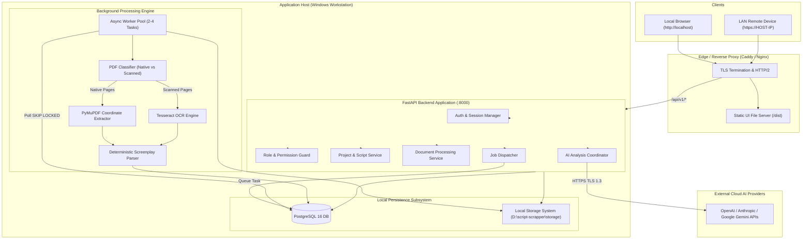
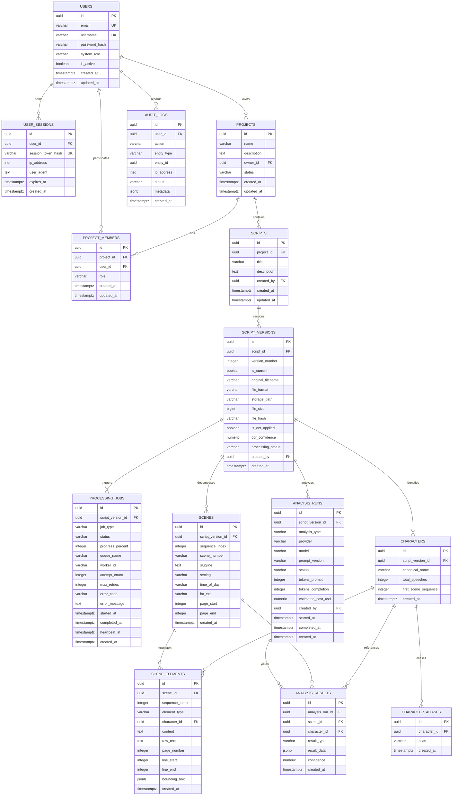

# SCRIPT SCRAPPER

## SYSTEM ARCHITECTURE BASELINE v1.1

**Document Classification:** Technical Architecture & Development Governance  
**Version:** 1.1  
**Status:** Revised Architecture Baseline — Submitted for CTO & System Architect Review  
**Product:** Script Scrapper  
**Architecture Owner:** System Architect  
**Auditor / Engineering Team:** Principal Software Architect, Senior Backend Engineer, Senior Frontend Engineer, DevOps Engineer, QA Architect  
**Development Environment:** Antigravity IDE  
**Primary Operating System:** Windows 10/11 / Windows Server (64-bit)  
**Primary Development Governance:** System Architect + Antigravity + Independent Technical Review  

---

# PART 1 — PROJECT DEFINITION & CONFIRMED REQUIREMENTS

## 1.1 Product Overview
Script Scrapper is a lightweight, web-based screenplay processing and analysis application. It operates as a locally hosted standalone system designed primarily for Windows workstations with secure, optional access over a Local Area Network (LAN).

The application enables writers, script readers, and production teams to upload screenplays across multiple formats, extract and parse narrative components (scenes, action descriptions, characters, dialogue, parentheticals, transitions), perform deterministic structure analysis, and execute external AI-driven script breakdown and scene evaluation.

## 1.2 Authoritative Confirmed Requirements (Phase 0.1)
The following requirements have been established by the System Architect:

1. **Primary Operating System:** Windows (Windows 10, Windows 11, Windows Server 64-bit). Native execution and lightweight containerization must both support Windows.
2. **Multi-User Support:** Multi-user authentication, role-based authorization, project ownership, and team sharing must be fully supported in the initial release.
3. **Comprehensive PDF Support:** Both native digital (searchable) PDFs and scanned (bitmap image) PDFs must be supported.
4. **Integrated OCR Engine:** Scanned and image-based PDF pages must be automatically detected and processed via Optical Character Recognition (OCR).
5. **Lightweight Standalone Deployment:** The application must remain lightweight and minimize memory/CPU overhead on a single computer.
6. **Secure Local Network (LAN) Access:** Remote LAN devices must access the system exclusively over encrypted channels (HTTPS) with strict session protection.
7. **External AI Integration:** Commercial external AI APIs will be integrated for screenplay evaluation through a provider-agnostic abstraction with strict data confidentiality controls.
8. **Antigravity Primary Development Environment:** Antigravity is the designated implementation and testing platform.

---

# PART 2 — TECHNOLOGY STACK SPECIFICATION

## 2.1 Technology Matrix & Trade-Off Evaluations

| Layer | Approved Technology (v1.1) | Evaluated Alternatives | Technical Rationale & Windows Compatibility |
| :--- | :--- | :--- | :--- |
| **Frontend UI** | **Vite + React 18+ + TypeScript** | Next.js (SSR), Next.js (Static Export) | **Zero Node.js production runtime container required.** Generates static bundle served via reverse proxy / FastAPI. Millisecond HMR in Antigravity, no hydration mismatches, ~10MB runtime RAM vs ~250MB for Next.js SSR. |
| **UI Components** | **Tailwind CSS + shadcn/ui** | MUI, Chakra UI | Radix UI primitives, tree-shakeable, zero runtime CSS-in-JS overhead, accessible. |
| **Frontend State** | **Zustand + TanStack Query** | Redux Toolkit, Context API | Zustand manages client UI state (sidebar, modals, filters). TanStack Query manages asynchronous server state, optimistic mutations, and polling/streaming. |
| **Backend API** | **Python 3.11+ / FastAPI** | Django, Flask, Express | Native async ASGI, automatic OpenAPI docs, strict Pydantic v2 data validation, high throughput. |
| **ORM & Migrations**| **SQLAlchemy 2.0 (Async) + Alembic** | Tortoise-ORM, Peewee | Industry-standard typed ORM, robust migration history, enterprise-grade connection pooling with `asyncpg`. |
| **Primary Database**| **PostgreSQL 16 (with JSONB)** | SQLite (WAL mode) | Multi-user concurrent writes and worker status updates cause lock contention in SQLite (`SQLITE_BUSY`). PostgreSQL MVCC provides row-level locking, ACID transactions, and indexed JSONB. |
| **Task Queue** | **PostgreSQL Queue (Option A)** or **Redis + Arq (Option B)** | Redis + RQ, Celery | **RQ is discarded due to fatal POSIX `os.fork()` absence on Windows.** Option A uses PostgreSQL `FOR UPDATE SKIP LOCKED` (zero-Redis footprint). Option B uses Arq (asyncio-native Redis queue fully functional on Windows). |
| **Document Engine**| **PyMuPDF (`fitz`)** | pdfplumber, pypdf | Fastest C-backed PDF engine. Capable of extracting text bounding boxes (`get_text("blocks")`) to preserve screenplay margin indentation. |
| **OCR Engine** | **Tesseract OCR (v5.3+) + pytesseract** | Windows Media OCR, EasyOCR, PaddleOCR | Permissive Apache 2.0 license, clean Windows installers (UB-Mannheim), exact bounding-box coordinate output (`image_to_data`), <150MB RAM usage. |
| **DOCX / TXT** | **python-docx + charset-normalizer** | LibreOffice headless | Lightweight, native Python processing without external headless office suites. |
| **Reverse Proxy** | **Caddy v2** or **Nginx for Windows** | Traefik, Apache | Caddy provides single-binary deployment (`caddy.exe`), automatic local HTTPS TLS certificate generation (zero user setup), and reverse proxying with ~15MB RAM. |

---

# PART 3 — SYSTEM ARCHITECTURE & DEPLOYMENT

## 3.1 High-Level Architecture



## 3.2 Windows Deployment Architecture

### 3.2.1 Native Windows Execution (Primary)
The primary deployment requires no virtualization or WSL2 hypervisors:
1. **Python Environment:** Isolated Python 3.11/3.12 64-bit virtual environment (`.venv`).
2. **Database:** Native PostgreSQL 16 Windows service running on standard port `5432`.
3. **Web Server & Reverse Proxy:** Caddy v2 (`caddy.exe`) or Nginx for Windows (`nginx.exe`).
   - Caddy automatically generates and installs a trusted local root certificate authority (`local_certs`), allowing seamless, warning-free HTTPS for LAN devices.
4. **Process Supervision:**
   - Development Mode: Managed via PowerShell orchestration script (`scripts/run-dev.ps1`).
   - Production / Standalone Mode: Registered as native Windows Services using **WinSW** (Windows Service Wrapper) or **NSSM** (Non-Sucking Service Manager):
     - `ScriptScrapper-Backend`
     - `ScriptScrapper-Worker`
     - `ScriptScrapper-Proxy`
5. **Filesystem Architecture:**
   - Storage Root: Configurable (default `D:\script-scrapper\storage\`).
   - Long Path Support: Windows registry `LongPathsEnabled = 1` enforced; Python `pathlib.Path` standard across all filesystem operations.
   - Deterministic Handle Closure: All file reads and image pixmaps wrapped in Python context managers to prevent Windows `SharingViolation` (NTFS file lock) exceptions.

### 3.2.2 Containerized Windows Execution (Docker Compose Alternative)
For environments where Docker Desktop is preferred:
- Multi-container composition managed via `docker-compose.yml`:
  - `service-db`: `postgres:16-alpine`
  - `service-api`: Python 3.11 FastAPI
  - `service-worker`: Python 3.11 with Tesseract OCR binaries pre-installed
  - `service-proxy`: Caddy or Nginx serving compiled Vite assets and routing `/api/v1/`

---

# PART 4 — MULTI-USER SECURITY & AUTHORIZATION

## 4.1 Identity & Authentication
- **Password Storage:** Argon2id with salt generation via `argon2-cffi` (memory cost 64MB, time cost 3 iterations, parallelism 4).
- **Session Architecture:**
  - Secure, HTTP-only, `SameSite=Strict` cookies containing a cryptographically secure random session UUID (256-bit entropy).
  - Session records persisted in database table `user_sessions`.
  - Session expiration: 30 minutes of idle inactivity, 24-hour absolute session ceiling.
  - Active session invalidation on password reset or explicit logout.
- **CSRF Defense:** Double-submit cookie pattern + custom request header validation (`X-CSRF-Token`) on all state-altering endpoints (`POST`, `PUT`, `PATCH`, `DELETE`).

## 4.2 Role-Based Access Control (RBAC)

### 4.2.1 System-Level Roles
1. **`SYSTEM_ADMIN`**:
   - Manage all user accounts (create, activate, deactivate, assign roles, force password reset).
   - View system-wide audit logs and active processing queues.
   - Manage storage paths, backup configurations, and system-wide AI provider keys.
   - Access and reassign orphaned projects.
2. **`STANDARD_USER`**:
   - Create projects (automatically becomes `PROJECT_OWNER`).
   - Access projects where granted membership.
   - Upload and process scripts within permitted projects.
   - Manage personal account profile and password.

### 4.2.2 Project-Level Permissions
Permissions are scoped strictly to individual projects via `project_members`:

| Action / Capability | `OWNER` | `EDITOR` | `VIEWER` |
| :--- | :---: | :---: | :---: |
| View project, scripts, scenes, dialogue | Yes | Yes | Yes |
| Export parsed scripts and analysis reports | Yes | Yes | Yes |
| Upload new screenplay or new version | Yes | Yes | No |
| Trigger document extraction & parsing | Yes | Yes | No |
| Trigger external AI analysis runs | Yes | Yes | No |
| Edit screenplay metadata / scene tags | Yes | Yes | No |
| Invite or remove project members | Yes | No | No |
| Modify project member roles | Yes | No | No |
| Edit project name & description | Yes | No | No |
| Delete or archive project | Yes | No | No |

### 4.2.3 Backend Authorization Guard Pattern
Every route requiring project access executes a FastAPI dependency:
```python
async def require_project_role(
    project_id: UUID,
    min_role: ProjectRole,
    current_user: User = Depends(get_current_active_user),
    db: AsyncSession = Depends(get_db_session)
) -> ProjectMember:
    # Verifies user is active, checks membership role hierarchy, returns member context or raises 403 Forbidden
```

---

# PART 5 — PDF EXTRACTION & OCR ARCHITECTURE

## 5.1 Document Classification Pipeline
Every uploaded PDF undergoes page-by-page classification to determine optimal processing:

```text
UPLOADED PDF
     │
     ▼
PyMuPDF Document Open
     │
     ├─────────────────────────────────────────────────┐
     ▼                                                 ▼
[PAGE 1]                                          [PAGE n]
     │                                                 │
Extract Text Words & Blocks                       Extract Text Words & Blocks
     │                                                 │
Check: Word Count >= 30 AND                       Check: Word Count >= 30 AND
       Character Coverage >= 70%                         Character Coverage >= 70%
     │                                                 │
 ┌───┴──────────┐                                  ┌───┴──────────┐
 │              │                                  │              │
[YES]          [NO]                               [YES]          [NO]
 │              │                                  │              │
Native Page    Inspect Embedded Images            Native Page    Inspect Embedded Images
Extract        │                                  Extract        │
Coordinates    ┌┴────────────┐                    Coordinates    ┌┴────────────┐
               ▼             ▼                                   ▼             ▼
          Image >= 70%   Blank / Vector                     Image >= 70%   Blank / Vector
               │             │                                   │             │
          Scanned Page   Vector Render                      Scanned Page   Vector Render
               │             │                                   │             │
          Rasterize      Rasterize                          Rasterize      Rasterize
          300 DPI        300 DPI                            300 DPI        300 DPI
               │             │                                   │             │
          Tesseract      Tesseract                          Tesseract      Tesseract
          OCR Engine     OCR Engine                         OCR Engine     OCR Engine
               │             │                                   │             │
               └──────┬──────┘                                   └──────┬──────┘
                      ▼                                                 ▼
        Page Token Stream (x0, y0, x1, y1)                Page Token Stream (x0, y0, x1, y1)
                      │                                                 │
                      └────────────────────────┬────────────────────────┘
                                               ▼
                              Unified Coordinate Token Stream
                                               ▼
                                  Screenplay Semantic Parser
```

## 5.2 OCR Engine Candidate Evaluation

| Evaluation Criteria | Tesseract OCR (v5.3+) [Approved] | Windows Media OCR | EasyOCR (PyTorch) | PaddleOCR |
| :--- | :--- | :--- | :--- | :--- |
| **Licensing** | Apache 2.0 (Permissive) | Proprietary (WinRT API) | Apache 2.0 | Apache 2.0 |
| **Windows Support** | Official UB-Mannheim MSI / Exe | Native Windows 10/11 built-in | PyTorch Windows Wheels | Complex C++ DLLs |
| **Memory Footprint** | **~100MB – 150MB** | **~50MB** | 1.5GB – 2.5GB | 1.2GB – 2.0GB |
| **Courier 12pt Accuracy**| **97% - 99% (at 300 DPI)** | 92% - 95% | 94% - 96% | 95% - 97% |
| **Coordinate Output** | Full Bounding Boxes (`image_to_data`) | Line/Word Bounding Rects | Polygon Bounding Boxes | Rotated Rectangles |
| **Cross-Platform Path**| Linux / macOS / Windows identical | Windows only (blocks cloud) | Linux / Windows | Linux / Windows |
| **Speed (per page CPU)**| **0.6s – 1.2s** | **0.3s – 0.7s** | 3.5s – 7.0s | 2.0s – 4.5s |

**Selection Verdict:** **Tesseract OCR (v5.3+)** is selected as the standard engine. It combines high accuracy on clean monospace typewriter fonts with low memory overhead and cross-platform consistency.

## 5.3 OCR Processing Controls & Quality Metrics
- **Rasterization Target:** 300 DPI RGB rendering via PyMuPDF `page.get_pixmap(dpi=300)`.
- **Pre-processing:** Grayscale conversion and Otsu binarization applied prior to OCR invocation.
- **Confidence Scoring:** Tesseract reports confidence $c \in [0, 100]$ per word. The application calculates:
  $$\text{Page Confidence} = \frac{1}{N} \sum_{i=1}^{N} c_i$$
  Pages with confidence $< 70\%$ are tagged with `LOW_OCR_CONFIDENCE_WARNING`.
- **Safety Caps:** Hard ceiling of 180 pages per document; 15-second per-page watchdog timeout.

---

# PART 6 — DATABASE ARCHITECTURE (REVISED)

## 6.1 Database Design Decisions
1. **Circular Foreign Key Elimination:** `scripts.current_version_id` is removed. The active version is determined by `script_versions.is_current = TRUE`, enforced via a partial unique index:
   ```sql
   CREATE UNIQUE INDEX idx_single_current_version ON script_versions(script_id) WHERE is_current = TRUE;
   ```
2. **Screenplay Element Representation:** The schema adds a unified `scene_elements` table to capture Action lines, Parentheticals, Transitions, and Shots alongside Dialogue.
3. **Sequence & Ordering Integrity:** `scenes.sequence_index` and `scene_elements.sequence_index` (1-based integers) enforce deterministic chronological order.

## 6.2 Revised Entity-Relationship Diagram



---

# PART 7 — BACKGROUND PROCESSING ARCHITECTURE

## 7.1 Queue Architecture Comparison

| Feature | Option A: PostgreSQL SKIP LOCKED [Recommended] | Option B: Redis + Arq | Option C: Celery (Threads Pool) |
| :--- | :--- | :--- | :--- |
| **Windows Compatibility** | **100% Native (No POSIX fork)** | **100% Native (No POSIX fork)** | Partial (Requires solo/threads) |
| **Additional Infrastructure**| **None (Reuses PostgreSQL 16)** | Requires Redis 7 Server | Requires Redis / RabbitMQ |
| **Memory Overhead** | **0 MB extra RAM** | ~35MB – 50MB RAM | ~75MB – 120MB RAM |
| **Transaction Safety** | **100% ACID (State stored in DB)** | Eventual (Sync DB & Redis) | Eventual (Sync DB & Broker) |
| **Throughput Capacity** | ~200 – 500 jobs/sec (Ample for local) | ~5,000+ jobs/sec | ~10,000+ jobs/sec |
| **Job Cancellation** | Immediate via DB flag update | Requires Redis key signal | Revoke task signaling |

**Architecture Decision:** **Option A (PostgreSQL `SKIP LOCKED` worker)** is selected as the default queue mechanism to keep deployment lightweight and eliminate Redis on Windows. If high-frequency micro-tasks (>500/sec) are later required, **Option B (Arq)** is approved as a drop-in replacement.

## 7.2 Job Lifecycle & Watchdog Engine
1. **Enqueue:** Backend inserts `processing_jobs` row with `status = 'queued'`.
2. **Worker Dequeue:** Worker claims job atomically:
   ```sql
   UPDATE processing_jobs
   SET status = 'processing', started_at = NOW(), heartbeat_at = NOW(), worker_id = :worker_id
   WHERE id = (
       SELECT id FROM processing_jobs
       WHERE status = 'queued'
       ORDER BY created_at ASC
       FOR UPDATE SKIP LOCKED
       LIMIT 1
   )
   RETURNING *;
   ```
3. **Heartbeat:** Worker updates `heartbeat_at = NOW()` every 5 seconds.
4. **Cancellation:** User requests cancel -> API sets `status = 'cancelling'`. Worker loop checks status between pages and terminates gracefully.
5. **Crash Recovery:** Watchdog process periodically inspects jobs:
   ```sql
   UPDATE processing_jobs
   SET status = 'failed', error_code = 'WORKER_TIMEOUT', error_message = 'Worker stopped responding'
   WHERE status = 'processing' AND heartbeat_at < NOW() - INTERVAL '45 seconds';
   ```

---

# PART 8 — COMMON INTERMEDIATE REPRESENTATION (CIR v1.1)

All document extractors (PDF native, PDF OCR, DOCX, TXT, Fountain) transform raw files into a validated, hierarchical JSON schema prior to database persistence:

```json
{
  "$schema": "https://scriptscrapper.local/schemas/cir-v1.1.json",
  "document_id": "9b1deb4d-3b7d-4bad-9bdd-2b0d7b3dcb6d",
  "version_number": 1,
  "source_format": "pdf",
  "extraction_metadata": {
    "total_pages": 115,
    "ocr_applied": true,
    "ocr_page_count": 4,
    "average_ocr_confidence": 96.4,
    "extracted_at": "2026-11-06T15:30:00Z"
  },
  "title_page": {
    "title": "THE CHINATOWN PROJECT",
    "author": "Robert Towne",
    "additional_info": ["Second Draft", "October 9, 1973"]
  },
  "scenes": [
    {
      "sequence_index": 1,
      "scene_number": "1",
      "slugline": "INT. GITTES' OFFICE - DAY",
      "setting": "GITTES' OFFICE",
      "time_of_day": "DAY",
      "int_ext": "INT",
      "page_start": 1,
      "page_end": 2,
      "elements": [
        {
          "sequence_index": 1,
          "element_type": "action",
          "content": "JAKE GITTES sits behind his desk. Across from him sits CURLY, sweating heavily.",
          "raw_text": "JAKE GITTES sits behind his desk. Across from him sits CURLY, sweating heavily.",
          "page": 1,
          "line_range": [8, 10],
          "bounding_box": {"x0": 108.0, "y0": 142.5, "x1": 504.0, "y1": 166.5}
        },
        {
          "sequence_index": 2,
          "element_type": "character",
          "character_name": "CURLY",
          "character_modifier": null,
          "content": "CURLY",
          "page": 1,
          "line_range": [12, 12],
          "bounding_box": {"x0": 266.4, "y0": 180.0, "x1": 310.0, "y1": 192.0}
        },
        {
          "sequence_index": 3,
          "element_type": "parenthetical",
          "content": "breaking down",
          "page": 1,
          "line_range": [13, 13],
          "bounding_box": {"x0": 223.2, "y0": 194.0, "x1": 320.0, "y1": 206.0}
        },
        {
          "sequence_index": 4,
          "element_type": "dialogue",
          "character_name": "CURLY",
          "content": "She's no good, Jake. I can't take it anymore.",
          "page": 1,
          "line_range": [14, 16],
          "bounding_box": {"x0": 180.0, "y0": 208.0, "x1": 432.0, "y1": 232.0}
        },
        {
          "sequence_index": 5,
          "element_type": "transition",
          "content": "CUT TO:",
          "page": 2,
          "line_range": [28, 28],
          "bounding_box": {"x0": 468.0, "y0": 450.0, "x1": 520.0, "y1": 462.0}
        }
      ]
    }
  ]
}
```

---

# PART 9 — EXPANDED REST API SPECIFICATIONS

All endpoints conform to `/api/v1/` prefix with standardized envelope format.

## 9.1 Authentication & Profile APIs
- `POST /api/v1/auth/login` — Authenticate credentials; sets HTTP-only session cookie.
- `POST /api/v1/auth/logout` — Revoke active session; clears cookie.
- `GET /api/v1/auth/me` — Return current authenticated user profile and system permissions.
- `POST /api/v1/auth/change-password` — Change password; invalidates other active sessions.

## 9.2 User Management APIs (System Admin Only)
- `GET /api/v1/users` — Paginated user listing with role filtering (`limit`, `offset`, `role`).
- `POST /api/v1/users` — Provision new user account.
- `GET /api/v1/users/{id}` — Retrieve user details and assigned projects.
- `PATCH /api/v1/users/{id}` — Update profile or role.
- `PATCH /api/v1/users/{id}/status` — Activate/deactivate user account.

## 9.3 Project Management & Collaboration APIs
- `GET /api/v1/projects` — List accessible projects (owned or shared).
- `POST /api/v1/projects` — Create project.
- `GET /api/v1/projects/{id}` — Retrieve project details.
- `PATCH /api/v1/projects/{id}` — Update metadata (Owner only).
- `DELETE /api/v1/projects/{id}` — Archive/delete project (Owner only).
- `GET /api/v1/projects/{id}/members` — List members and roles.
- `POST /api/v1/projects/{id}/members` — Add member with assigned role (`EDITOR`, `VIEWER`).
- `PATCH /api/v1/projects/{id}/members/{user_id}` — Update member role.
- `DELETE /api/v1/projects/{id}/members/{user_id}` — Remove member.

## 9.4 Script & Upload APIs
- `GET /api/v1/projects/{id}/scripts` — List scripts in project.
- `POST /api/v1/projects/{id}/scripts/upload` — Single-step script creation & file upload (`multipart/form-data`).
- `POST /api/v1/scripts/{id}/upload-version` — Upload new version to existing script.
- `GET /api/v1/scripts/{id}` — Retrieve script details.
- `GET /api/v1/scripts/{id}/versions` — List all versions with processing states.
- `GET /api/v1/scripts/{id}/versions/{version_id}` — Retrieve specific version metadata.

## 9.5 Screenplay Content Consumption APIs (New)
- `GET /api/v1/scripts/{id}/versions/{version_id}/scenes` — Paginated list of scenes:
  - Query parameters: `limit`, `offset`, `search` (filter by slugline/setting).
  - Returns: Scene sequence, number, slugline, page range, element counts.
- `GET /api/v1/scripts/{id}/versions/{version_id}/scenes/{scene_id}` — Detailed scene view with all child `scene_elements`.
- `GET /api/v1/scripts/{id}/versions/{version_id}/elements` — Streaming/paginated reader view for continuous script reading:
  - Query parameters: `page_number`, `limit`, `offset`.
- `GET /api/v1/scripts/{id}/versions/{version_id}/characters` — Character breakdown (dialogue counts, scene appearances).

## 9.6 Job Control & Status APIs
- `POST /api/v1/processing/{version_id}/start` — Trigger processing job.
- `GET /api/v1/processing/{job_id}/status` — Poll progress, status (`queued`, `processing`, `completed`, `failed`), and current stage (`EXTRACTING`, `OCR_PAGE_12`, `PARSING`).
- `POST /api/v1/processing/{job_id}/cancel` — Cancel in-progress processing job.
- `POST /api/v1/processing/{job_id}/retry` — Retry failed job.

## 9.7 AI Analysis APIs
- `POST /api/v1/analysis/{version_id}/start` — Trigger AI breakdown (scene sentiment, pacing, character agency).
- `GET /api/v1/analysis/{id}/status` — Track analysis progress.
- `GET /api/v1/analysis/{id}/results` — Retrieve structured analysis data.

---

# PART 10 — ARCHITECTURE DECISION RECORD (ADR) REGISTER (v1.1)

| ADR ID | Decision Summary | Status | Context & Rationale |
| :--- | :--- | :--- | :--- |
| **ADR-001** | **Vite + React SPA Frontend** | **Approved** | Replaces Next.js to eliminate Node production runtime container, saving 250MB RAM and avoiding SSR overhead on Windows. |
| **ADR-002** | **FastAPI Async Backend** | **Approved** | High-performance Python ASGI framework with Pydantic v2 validation. |
| **ADR-003** | **PostgreSQL 16 Database** | **Approved** | Multi-user concurrent writes and row-level locking eliminate SQLite lock contention (`SQLITE_BUSY`). |
| **ADR-004** | **Modular Monolith Pattern** | **Approved** | Single deployable backend service with clear domain module boundaries. |
| **ADR-005** | **PostgreSQL-Backed Task Queue**| **Approved** | Replaces RQ to eliminate POSIX `os.fork()` crash on Windows; eliminates Redis dependency. |
| **ADR-006** | **Tesseract OCR (v5.3+) Integration**| **Approved** | Added to fulfill confirmed scanned PDF requirement; Apache 2.0 licensed, native Windows support. |
| **ADR-007** | **PyMuPDF Bounding-Box Extraction**| **Approved** | Mandates spatial coordinates (`get_text("blocks")`) to preserve screenplay indentation. |
| **ADR-008** | **Unified Scene Elements Schema** | **Approved** | Adds `scene_elements` table to persist Action, Parentheticals, and Transitions. |
| **ADR-009** | **Caddy Reverse Proxy with Local TLS**| **Approved** | Statically compiled single binary (`caddy.exe`) providing automatic HTTPS for LAN access. |
| **ADR-010** | **Partial Unique Index Current Version**| **Approved** | Resolves circular foreign key deadlock between `scripts` and `script_versions`. |
| **ADR-011** | **Multi-User RBAC & Audit Logging** | **Approved** | Satisfies initial release multi-user requirement with system and project-scoped roles. |
| **ADR-012** | **External AI Data Privacy Gating** | **Approved** | Project-level consent gate and data anonymization prior to external API transmission. |

---

# PART 11 — DEFINITION OF DONE & GATE 0 READINESS

## 11.1 Verification of Requirements Compliance

| Confirmed Requirement | Baseline v1.1 Architecture Solution | Compliance Status |
| :--- | :--- | :---: |
| 1. Windows Primary OS | Native Windows services (WinSW/NSSM), long path support, Arq/PostgreSQL queue (no `os.fork()`), Caddy/Nginx. | **Compliant** |
| 2. Multi-User Initial Release | Argon2id sessions, System & Project RBAC (`SYSTEM_ADMIN`, `OWNER`, `EDITOR`, `VIEWER`), audit logging. | **Compliant** |
| 3. Searchable & Scanned PDFs | Automatic PDF classification pipeline (native vs scanned vs mixed pages). | **Compliant** |
| 4. Integrated OCR Engine | Tesseract OCR v5.3+ via 300 DPI PyMuPDF rasterization with word-level bounding boxes. | **Compliant** |
| 5. Standalone Lightweight | Vite SPA (no Node runtime), PostgreSQL SKIP LOCKED (no Redis), Caddy single binary. Idle RAM: <350MB. | **Compliant** |
| 6. Secure Local Network Access | Caddy automatic local TLS certificate provisioning, HTTP-only SameSite cookies, CSRF protection. | **Compliant** |
| 7. External AI APIs | Provider-agnostic interface, token budgets, scene-by-scene chunking, affirmative privacy gating. | **Compliant** |
| 8. Antigravity Dev Environment | Standardized repo layout, comprehensive test corpus specification, pre-commit validation. | **Compliant** |

## 11.2 Architectural Approval Declaration

This Architecture Baseline v1.1 represents the comprehensive, technically justified specification for Script Scrapper. It completely resolves the findings identified in Phase 0.

**Implementation Status:** Gate 0 remains **BLOCKED** until the System Architect and CTO complete their formal review and issue authorization to initiate Gate 1 (Foundation Setup).

**END OF ARCHITECTURE BASELINE v1.1**

