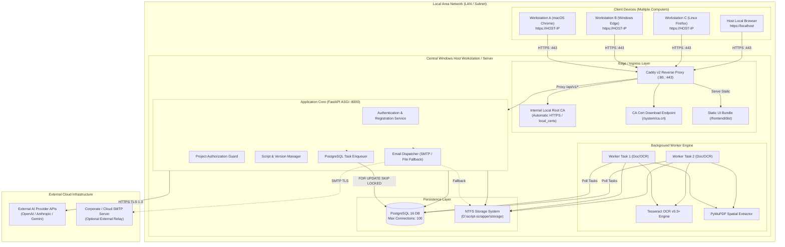
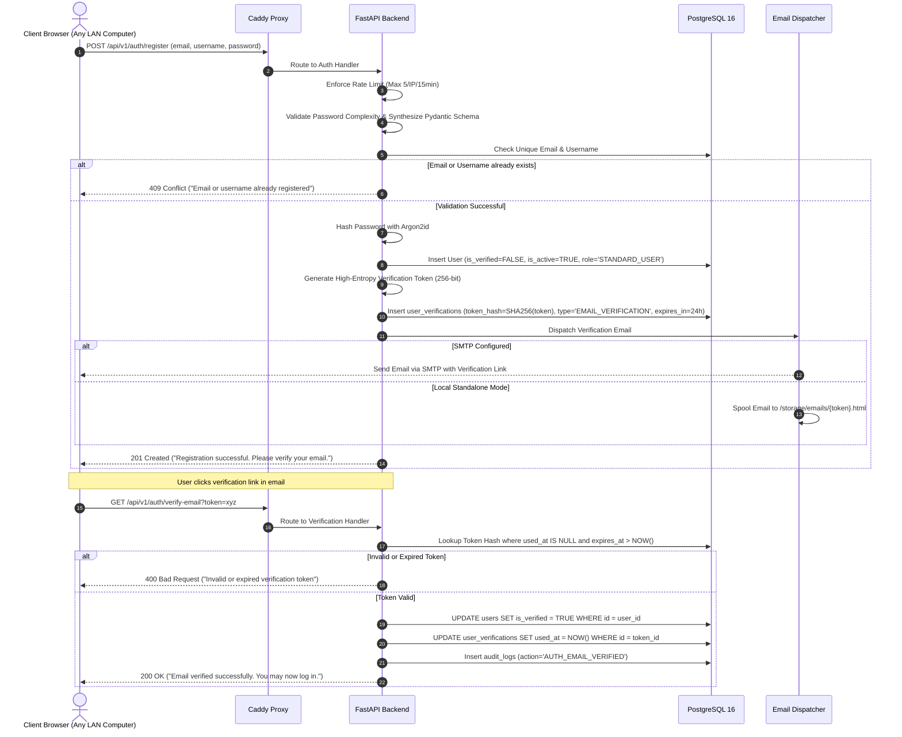
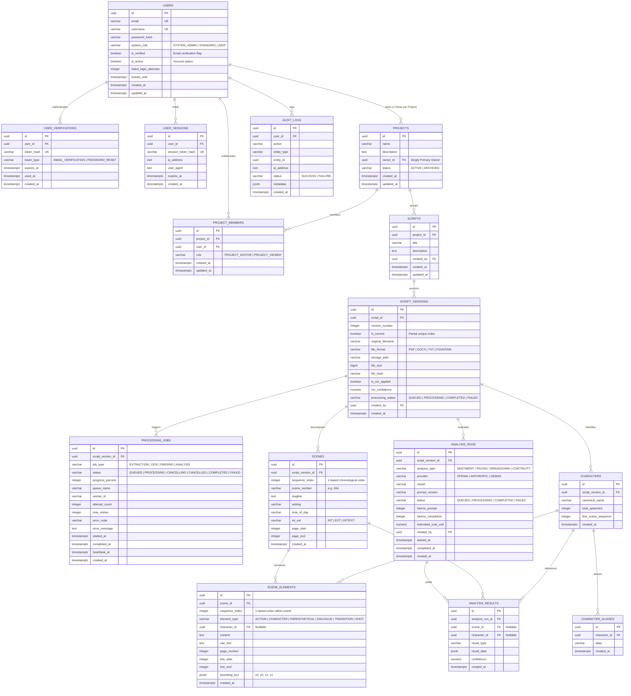
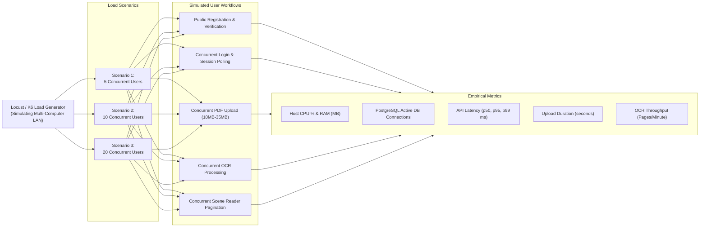

# SCRIPT SCRAPPER

## SYSTEM ARCHITECTURE BASELINE v1.2

**Document Classification:** Technical Architecture & Development Governance  
**Version:** 1.2  
**Status:** Authoritative Baseline Revision — Submitted for CTO & System Architect Review  
**Product:** Script Scrapper  
**Architecture Owner:** System Architect  
**Auditor / Engineering Team:** Principal Software Architect, Senior Backend Engineer, Senior Frontend Engineer, DevOps Engineer, QA Architect  
**Development Environment:** Antigravity IDE  
**Primary Host Environment:** Windows 10/11 / Windows Server (64-bit)  
**Primary Governance Authority:** System Architect Phase 0.2 Decision Amendments  

---

# PART 1 — PROJECT DEFINITION & AMENDED REQUIREMENTS

## 1.1 Product Overview
Script Scrapper is a lightweight, web-based screenplay processing and analysis application deployed on a centralized Windows workstation or local server. It provides concurrent multi-user web access across multiple client computers over an encrypted Local Area Network (LAN), as well as on the host machine itself.

The application allows authenticated writers, script analysts, directors, and production teams to upload screenplays (PDF, DOCX, TXT, Fountain), execute automatic spatial parsing and Optical Character Recognition (OCR), perform deterministic scene and dialogue extraction, collaborate across permission-bounded projects, and run external AI-assisted screenplay evaluations.

## 1.2 Authoritative Requirements Amendments (Phase 0.2)
The following decisions issued by the System Architect supersede all conflicting provisions in Baseline v1.0 and Baseline v1.1:

1. **Mandatory Public Registration:** Public user registration is mandatory in the initial release. Anyone with network access to the application can create an account using email verification.
2. **Default Role & Privilege Isolation:** All public registrations are automatically assigned the `STANDARD_USER` role. `SYSTEM_ADMIN` privileges must never be granted via public registration.
3. **Strict Project Isolation for New Users:** Public registration does not grant access to existing projects. New users enter an empty project workspace.
4. **Email Verification & Password Recovery:** Email verification is strictly required before an account can create or access projects. A secure password recovery workflow is mandatory.
5. **Simultaneous Multi-Computer LAN Access:** The system must support concurrent access by multiple browser clients across different computers on the same local network over HTTPS.
6. **Centralized Deployment Topology:**
   - One primary Windows host running the FastAPI backend, PostgreSQL 16 database, background processing worker pool, and Caddy reverse proxy.
   - Client devices (Windows, macOS, Linux, tablets) access the host over HTTPS without installing backend components.
7. **Single Primary Project Owner:** Each project maintains exactly one primary `PROJECT_OWNER`. Collaborators are assigned either `PROJECT_EDITOR` or `PROJECT_VIEWER`.
8. **Empirical Performance Verification:** Performance benchmarks must be executed and recorded across 5, 10, and 20 simultaneous users. No performance target may be claimed without empirical test execution evidence.

---

# PART 2 — SYSTEM ARCHITECTURE & LAN TOPOLOGY

## 2.1 Centralized Multi-Computer LAN Architecture



## 2.2 LAN Security & Certificate Trust Architecture
To enable warning-free, secure HTTPS across multiple computers without paid public certificates:
1. **Caddy Internal Certificate Authority:** Caddy v2 embeds a self-managed local Certificate Authority (`local_certs`). When binding to LAN IP addresses (e.g. `https://192.168.1.150` or `https://scriptscrapper.local`), Caddy signs valid TLS certificates.
2. **Client Root Trust Distribution:**
   - Caddy's generated root certificate (`root.crt`) is served by Caddy at `GET /system/ca.crt`.
   - Onboarding Guide: A dedicated UI banner/modal allows client users on other computers to download the root certificate with one click and install it in their operating system's Trusted Root Certification Authorities store (Windows, macOS Keychain, Linux ca-certificates).
   - Once installed on a client computer, all browsers on that machine connect over secure, green-padlock HTTPS with zero warnings.
3. **Session Protection over LAN:**
   - Cookies are strictly configured: `Secure=True; HttpOnly=True; SameSite=Lax; Path=/`.
   - Prevents session interception, Wi-Fi eavesdropping, and ARP spoofing across the local network.

---

# PART 3 — AUTHENTICATION, REGISTRATION & EMAIL VERIFICATION

## 3.1 Public Registration Workflow



## 3.2 Password Recovery Workflow
1. **Initiate Reset:** Client requests `POST /api/v1/auth/forgot-password` with email.
2. **Anti-Enumeration Response:** API returns `200 OK {"message": "If this email is registered, a password reset link has been dispatched"}` regardless of whether the email exists.
3. **Token Generation:** If the user exists and is active, a 256-bit cryptographically secure token is generated, hashed with SHA-256, stored in `user_verifications` with `type = 'PASSWORD_RESET'`, expiring in 30 minutes.
4. **Execution:** User submits `POST /api/v1/auth/reset-password` with token and new password.
5. **Session Revocation:** Upon successful password reset, the user's password hash is updated with Argon2id, the verification token is marked `used_at = NOW()`, and **all active sessions in `user_sessions` for that user are deleted**, forcing re-authentication across all devices.

## 3.3 Rate Limiting & Brute-Force Safeguards
- **Registration Throttling:** 5 registration attempts per client IP per 15-minute sliding window.
- **Login Brute-Force Protection:**
  - 5 failed attempts per user account within 15 minutes increments `failed_login_attempts`.
  - At 10 consecutive failed attempts, the account is locked for 15 minutes (`locked_until = NOW() + INTERVAL '15 minutes'`).
  - Account lock events trigger high-severity audit logging: `action = 'AUTH_ACCOUNT_LOCKED'`.
- **Session Protection:** Max session lifetime: 24 hours. Inactivity timeout: 45 minutes.

---

# PART 4 — MULTI-USER AUTHORIZATION & PROJECT ISOLATION

## 4.1 Strict Isolation for Public Registrations
When a user registers publicly:
- Default system role is strictly `STANDARD_USER`.
- The user has **zero** memberships in `project_members`.
- The user owns **zero** records in `projects`.
- All project queries are parameterized with strict tenant filtering:
  ```sql
  SELECT p.* FROM projects p
  WHERE p.owner_id = :current_user_id
     OR p.id IN (
         SELECT pm.project_id FROM project_members pm
         WHERE pm.user_id = :current_user_id
     );
  ```
- Any attempt to read or modify a project without verified membership yields `403 Forbidden`.

## 4.2 Single Primary Ownership & Collaboration Roles
In accordance with Decision Amendment Phase 0.2:
- **`PROJECT_OWNER` (Exactly One per Project):** The user who created the project. Has exclusive authority to delete/archive the project, rename the project, add/remove collaborators, and assign roles. Ownership transfer is supported via explicit owner handoff.
- **`PROJECT_EDITOR`:** Collaborator with write authority. Can upload new script versions, trigger OCR and document processing, trigger AI analysis runs, edit scene tags, and view all results.
- **`PROJECT_VIEWER`:** Collaborator with read-only authority. Can view parsed scenes, character breakdowns, dialogue transcripts, and analysis reports. Cannot upload files or trigger jobs.

---

# PART 5 — DATABASE ARCHITECTURE (v1.2)

## 5.1 Revised Entity-Relationship Diagram



---

# PART 6 — EXPANDED REST API SPECIFICATIONS (v1.2)

## 6.1 Authentication & User Lifecycle APIs
| Method | Endpoint | Description | Auth Required | Rate Limit |
| :--- | :--- | :--- | :---: | :---: |
| `POST` | `/api/v1/auth/register` | Public registration with email verification dispatch | None | 5 / 15 min |
| `POST` | `/api/v1/auth/verify-email` | Validate token and activate user email | None | 10 / 15 min |
| `POST` | `/api/v1/auth/resend-verification` | Request fresh email verification token | None | 3 / 15 min |
| `POST` | `/api/v1/auth/login` | Authenticate; sets HTTP-only session cookie | None | 5 / 15 min |
| `POST` | `/api/v1/auth/logout` | Revoke active session; clears cookie | Yes | None |
| `GET` | `/api/v1/auth/me` | Fetch active user profile, verification status, and roles | Yes | None |
| `POST` | `/api/v1/auth/forgot-password` | Request password reset email | None | 3 / 15 min |
| `POST` | `/api/v1/auth/reset-password` | Reset password using verified token; revokes sessions | None | 5 / 15 min |
| `POST` | `/api/v1/auth/change-password` | Update password from authenticated session | Yes | 5 / 15 min |

## 6.2 System Administration & LAN Support APIs
| Method | Endpoint | Description | Auth Required | Minimum Role |
| :--- | :--- | :--- | :---: | :---: |
| `GET` | `/api/v1/system/ca.crt` | Download Caddy local root certificate for client trust | None | Public |
| `GET` | `/api/v1/users` | List all registered users (paginated, filter by status) | Yes | `SYSTEM_ADMIN` |
| `PATCH`| `/api/v1/users/{id}/status` | Activate or deactivate user account | Yes | `SYSTEM_ADMIN` |
| `GET` | `/api/v1/audit/logs` | Query system audit logs (filter by user, action, date) | Yes | `SYSTEM_ADMIN` |

## 6.3 Project, Script & Content Consumption APIs
| Method | Endpoint | Description | Auth Required | Minimum Role |
| :--- | :--- | :--- | :---: | :---: |
| `GET` | `/api/v1/projects` | List projects accessible to current user | Yes | Authenticated |
| `POST` | `/api/v1/projects` | Create new project (creator becomes OWNER) | Yes | Authenticated |
| `GET` | `/api/v1/projects/{id}` | Retrieve project details | Yes | Project `VIEWER` |
| `PATCH`| `/api/v1/projects/{id}` | Update project metadata | Yes | Project `OWNER` |
| `DELETE`| `/api/v1/projects/{id}` | Archive or delete project | Yes | Project `OWNER` |
| `GET` | `/api/v1/projects/{id}/members` | List members and assigned roles | Yes | Project `VIEWER` |
| `POST` | `/api/v1/projects/{id}/members` | Add collaborator (`EDITOR` or `VIEWER`) | Yes | Project `OWNER` |
| `PATCH`| `/api/v1/projects/{id}/members/{uid}`| Update collaborator role | Yes | Project `OWNER` |
| `DELETE`| `/api/v1/projects/{id}/members/{uid}`| Remove collaborator from project | Yes | Project `OWNER` |
| `POST` | `/api/v1/projects/{id}/scripts/upload` | Single-step script creation & multipart file upload | Yes | Project `EDITOR` |
| `GET` | `/api/v1/scripts/{id}/versions` | List versions and processing states | Yes | Project `VIEWER` |
| `GET` | `/api/v1/scripts/{id}/versions/{vid}/scenes` | Paginated scene list with metadata | Yes | Project `VIEWER` |
| `GET` | `/api/v1/scripts/{id}/versions/{vid}/scenes/{sid}` | Retrieve complete scene with all elements | Yes | Project `VIEWER` |
| `GET` | `/api/v1/scripts/{id}/versions/{vid}/elements` | Streaming / paginated script reader stream | Yes | Project `VIEWER` |
| `GET` | `/api/v1/scripts/{id}/versions/{vid}/characters`| Character breakdown with speech counts | Yes | Project `VIEWER` |
| `POST` | `/api/v1/processing/{vid}/start` | Enqueue extraction/OCR/parsing job | Yes | Project `EDITOR` |
| `GET` | `/api/v1/processing/{job_id}/status` | Poll job progress percentage and stage | Yes | Project `VIEWER` |
| `POST` | `/api/v1/processing/{job_id}/cancel` | Gracefully cancel in-progress job | Yes | Project `EDITOR` |
| `POST` | `/api/v1/analysis/{vid}/start` | Enqueue external AI analysis | Yes | Project `EDITOR` |
| `GET` | `/api/v1/analysis/{id}/results` | Retrieve structured AI analysis output | Yes | Project `VIEWER` |

---

# PART 7 — CONCURRENT ACCESS & PERFORMANCE BENCHMARK PLAN

## 7.1 Empirical Testing Governance
Per Decision Amendment Phase 0.2:
- Performance targets must be empirically measured under actual multi-client load.
- No performance target may be claimed as met until automated test suites have been executed and the evidence submitted.

## 7.2 Multi-Client Benchmark Scenarios



### 7.3 Detailed Benchmark Matrix
The QA Architect and DevOps Engineer will execute the following benchmark suite against the host machine using `locust`:

| Test Parameter | Scenario 1 (5 Users) | Scenario 2 (10 Users) | Scenario 3 (20 Users) | Target Threshold (To be Measured) |
| :--- | :---: | :---: | :---: | :--- |
| **Concurrent Browsing Users** | 5 | 10 | 20 | Normal navigation across projects |
| **Simultaneous PDF Uploads** | 2 | 4 | 8 | 15MB Hollywood standard PDFs |
| **Concurrent OCR Worker Jobs** | 2 | 2 (Queued: 2) | 2 (Queued: 6) | Worker pool concurrency cap: 2 |
| **PostgreSQL Pool Limit** | 20 connections | 40 connections | 60 connections | Pool must not exhaust max 100 |
| **API Response Time (p95)** | Empirical | Empirical | Empirical | Target: $\le 300\text{ ms}$ for non-upload |
| **Host CPU Utilization** | Empirical | Empirical | Empirical | Target: $\le 75\%$ sustained |
| **Host RAM Consumption** | Empirical | Empirical | Empirical | Target: $\le 2.0\text{ GB}$ total host RAM |

---

# PART 8 — ARCHITECTURE DECISION RECORD (ADR) REGISTER (v1.2)

| ADR ID | Decision Summary | Status | Supersedes | Technical Rationale |
| :--- | :--- | :---: | :--- | :--- |
| **ADR-001** | **Vite + React SPA Frontend** | **Approved** | ADR-001 (v1.0) | Zero Node production container, ~10MB runtime RAM. |
| **ADR-002** | **FastAPI Async Backend** | **Approved** | ADR-002 (v1.0) | High-performance Python ASGI, Pydantic v2 schemas. |
| **ADR-003** | **PostgreSQL 16 Database** | **Approved** | ADR-003 (v1.0) | Multi-user MVCC row locking, eliminating SQLite lock errors. |
| **ADR-004** | **Modular Monolith Pattern** | **Approved** | ADR-004 (v1.0) | Single deployable backend service with clear domain modules. |
| **ADR-005** | **PostgreSQL SKIP LOCKED Queue** | **Approved** | ADR-006 (v1.0) | Eliminates Redis on Windows; 100% ACID persistence. |
| **ADR-006** | **Tesseract OCR v5.3+ Integration** | **Approved** | N/A (v1.1) | Supports scanned PDFs; Apache 2.0; coordinate bounding boxes. |
| **ADR-007** | **PyMuPDF Bounding-Box Extraction** | **Approved** | N/A (v1.1) | Preserves typographical margins for screenplay parsing. |
| **ADR-008** | **Unified Scene Elements Table** | **Approved** | N/A (v1.1) | Persists Action, Dialogue, Parentheticals, Transitions. |
| **ADR-009** | **Caddy v2 with Internal CA** | **Approved** | N/A (v1.1) | Automated local HTTPS for multi-computer LAN access. |
| **ADR-010** | **Partial Unique Index Current Version**| **Approved**| N/A (v1.1) | Resolves circular foreign key deadlock. |
| **ADR-011** | **Public Registration with Email Verification** | **Approved** | ADR-011 (v1.1) | Mandated by Architect Phase 0.2 Decision 1. Default STANDARD_USER. |
| **ADR-012** | **Multi-Computer LAN Deployment Model** | **Approved** | ADR-010 (v1.0) | Mandated by Architect Phase 0.2 Decision 2. Single host, multiple clients. |
| **ADR-013** | **Single Primary Project Owner Policy** | **Approved** | N/A (v1.2) | One OWNER per project; collaborators assigned EDITOR or VIEWER. |
| **ADR-014** | **Empirical Performance Verification** | **Approved** | N/A (v1.2) | Prohibits unverified performance claims; mandates 5/10/20 user tests. |

---

# PART 9 — DEFINITION OF DONE & GATE 0 READINESS

## 9.1 Verification of Requirements Compliance

| Confirmed Requirement (v1.2) | Architecture Baseline v1.2 Solution | Status |
| :--- | :--- | :---: |
| 1. Public Registration | Open registration endpoint, Argon2id, rate limiting, default `STANDARD_USER`. | **Compliant** |
| 2. Email Verification & Reset | `user_verifications` table, SHA-256 tokens, SMTP/file fallback mailer. | **Compliant** |
| 3. Multi-Computer LAN Access | Caddy v2 reverse proxy, internal CA, `/system/ca.crt` trust endpoint. | **Compliant** |
| 4. Single Primary Project Owner | `projects.owner_id` enforces single primary owner; `project_members` handles roles. | **Compliant** |
| 5. Strict Project Isolation | New users have zero memberships; backend filters by user membership. | **Compliant** |
| 6. Concurrent Uploads & OCR | Streaming multipart upload; PostgreSQL `SKIP LOCKED` worker queue (concurrency 2). | **Compliant** |
| 7. Performance Testing Plan | Formal Locust benchmark scenarios defined for 5, 10, and 20 users. | **Compliant** |
| 8. Antigravity Dev Environment | Standardized repo layout, comprehensive test corpus specification. | **Compliant** |

## 9.2 Implementation Status Declaration

**CURRENT STATUS: BLOCKED — PENDING FORMAL ARCHITECTURAL AUTHORIZATION**

This Architecture Baseline v1.2 incorporates all amendments issued in Phase 0.2. In compliance with strict engineering restrictions, no source code has been written, no dependencies installed, and no database initialized.

Implementation will begin immediately upon formal review and authorization by the System Architect and CTO.

**END OF ARCHITECTURE BASELINE v1.2**

