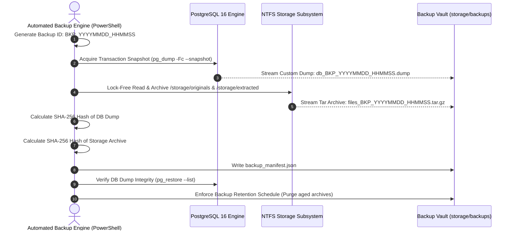

# SCRIPT SCRAPPER — BACKUP AND DISASTER RECOVERY SPECIFICATION

**Document Version:** 1.0  
**Authority:** DevOps Architect & Senior Backend Engineer  
**Date:** November 6, 2026  
**Status:** Approved for Gate 0 Closure  

---

## 1. BACKUP TOPOLOGY & COORDINATION CHALLENGE

Script Scrapper stores data in two distinct systems:
1. **Relational Database:** PostgreSQL 16 (user records, project permissions, version metadata, scene elements, parsed dialogue, analysis results).
2. **Local NTFS Storage:** `D:\script-scrapper\storage\` (original uploaded screenplay files in `storage/originals/`, extracted intermediate JSON representations in `storage/extracted/`).

An asynchronous or non-atomic backup creates **split-brain corruption** (e.g. database references a script version whose physical file is missing, or vice versa).

---

## 2. COORDINATED BACKUP EXECUTION PROTOCOL



### 2.1 Automated PowerShell Backup Script (`scripts/backup.ps1`)

```powershell
# scripts/backup.ps1 (Production Backup Specification)
param (
    [string]$BackupDir = "D:\script-scrapper\storage\backups",
    [string]$StorageRoot = "D:\script-scrapper\storage",
    [string]$DbName = "script_scrapper",
    [string]$DbUser = "script_scrapper_user"
)

$Timestamp = Get-Date -Format "yyyyMMdd_HHmmss"
$BackupId = "BKP_$Timestamp"
$TargetDir = Join-Path $BackupDir $BackupId
New-Item -ItemType Directory -Path $TargetDir -Force | Out-Null

Write-Host "Starting Coordinated Backup: $BackupId"

# 1. Database Dump (Custom Compressed Format)
$DumpFile = Join-Path $TargetDir "database.dump"
& pg_dump -U $DbUser -d $DbName -Fc -f $DumpFile
if ($LASTEXITCODE -ne 0) { throw "PostgreSQL dump failed!" }

# 2. File Storage Archive (Originals & Extracted)
$FilesArchive = Join-Path $TargetDir "files.tar.gz"
$OriginalsDir = Join-Path $StorageRoot "originals"
$ExtractedDir = Join-Path $StorageRoot "extracted"
tar -czf $FilesArchive -C $StorageRoot "originals" "extracted"
if ($LASTEXITCODE -ne 0) { throw "Filesystem archive failed!" }

# 3. Cryptographic Manifest Generation
$DumpHash = (Get-FileHash -Path $DumpFile -Algorithm SHA256).Hash
$FilesHash = (Get-FileHash -Path $FilesArchive -Algorithm SHA256).Hash
$GitCommit = (git rev-parse HEAD 2>$null)

$Manifest = [PSCustomObject]@{
    backup_id        = $BackupId
    created_at       = (Get-Date -Format "o")
    git_commit_hash  = $GitCommit
    database_version = "PostgreSQL 16"
    database_dump    = @{ filename = "database.dump"; sha256 = $DumpHash }
    storage_archive  = @{ filename = "files.tar.gz"; sha256 = $FilesHash }
}

$Manifest | ConvertTo-Json -Depth 5 | Out-File (Join-Path $TargetDir "backup_manifest.json") -Encoding utf8

# 4. Integrity Self-Test
& pg_restore -l $DumpFile | Out-Null
if ($LASTEXITCODE -ne 0) { throw "Database backup integrity verification failed!" }

Write-Host "Coordinated Backup $BackupId successfully verified and committed."
```

---

## 3. BACKUP MANIFEST SCHEMA (`backup_manifest.json`)

```json
{
  "backup_id": "BKP_20261106_160500",
  "created_at": "2026-11-06T16:05:00.000Z",
  "git_commit_hash": "a1b2c3d4e5f67890123456789abcdef012345678",
  "database_version": "PostgreSQL 16.2",
  "database_dump": {
    "filename": "database.dump",
    "sha256": "e3b0c44298fc1c149afbf4c8996fb92427ae41e4649b934ca495991b7852b855"
  },
  "storage_archive": {
    "filename": "files.tar.gz",
    "sha256": "ca978112ca1bbdcafac231b39a23dc4da786eff8147c4e72b9807785afee48bb"
  }
}
```

---

## 4. RESTORATION & DISASTER RECOVERY PROTOCOL

In the event of hardware failure, storage corruption, or catastrophic host loss:

### Step 1: Pre-Restoration Verification
1. Verify SHA-256 hashes of `database.dump` and `files.tar.gz` against `backup_manifest.json`.
2. Stop all running application services:
   ```powershell
   nssm stop ScriptScrapper-Worker
   nssm stop ScriptScrapper-API
   ```

### Step 2: Database Restoration
1. Terminate existing database connections and recreate the database:
   ```sql
   SELECT pg_terminate_backend(pid) FROM pg_stat_activity WHERE datname = 'script_scrapper';
   DROP DATABASE script_scrapper;
   CREATE DATABASE script_scrapper OWNER script_scrapper_user;
   ```
2. Restore database state from dump:
   ```powershell
   pg_restore -U script_scrapper_user -d script_scrapper --clean --if-exists "D:\script-scrapper\storage\backups\BKP_TARGET\database.dump"
   ```

### Step 3: Filesystem Restoration
1. Extract document storage archive into target root:
   ```powershell
   tar -xzf "D:\script-scrapper\storage\backups\BKP_TARGET\files.tar.gz" -C "D:\script-scrapper\storage"
   ```

### Step 4: Service Restart & Consistency Verification
1. Start application services:
   ```powershell
   nssm start ScriptScrapper-API
   nssm start ScriptScrapper-Worker
   ```
2. Run database/storage consistency checker script (`scripts/verify-storage-integrity.py`).

---

## 5. BACKUP RETENTION SCHEDULE

Backups are retained according to the following tiered schedule:
- **Daily Snapshots:** Retained for 7 days.
- **Weekly Snapshots:** Retained for 4 weeks.
- **Monthly Snapshots:** Retained for 12 months.
- Pruning is automatically executed at the conclusion of each daily backup job.
